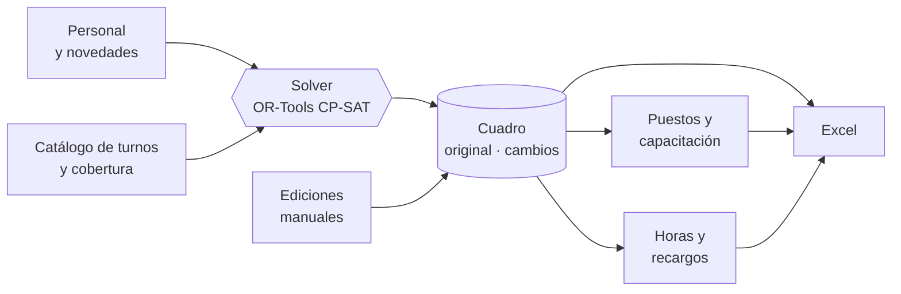
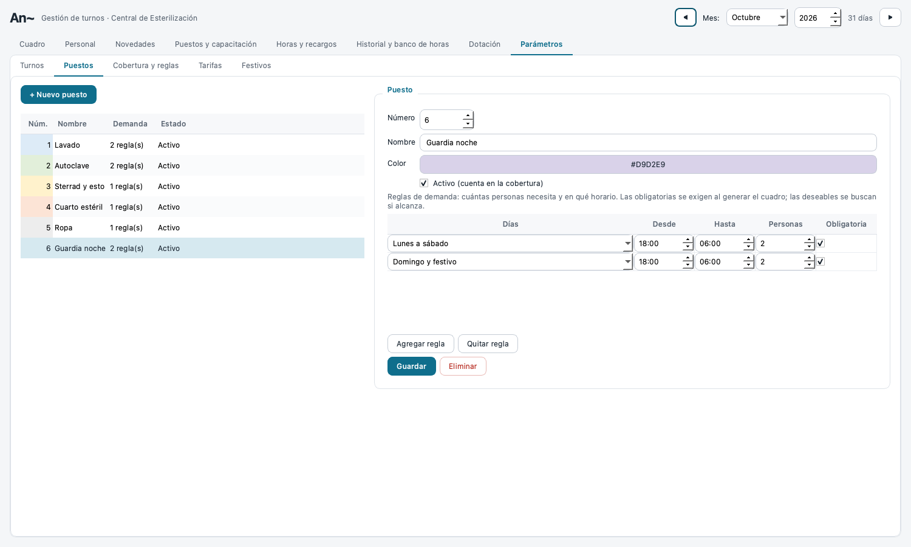
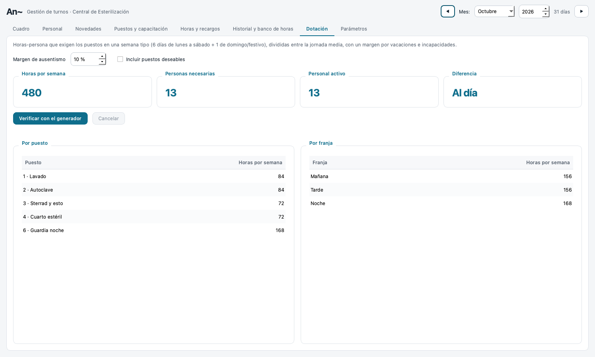
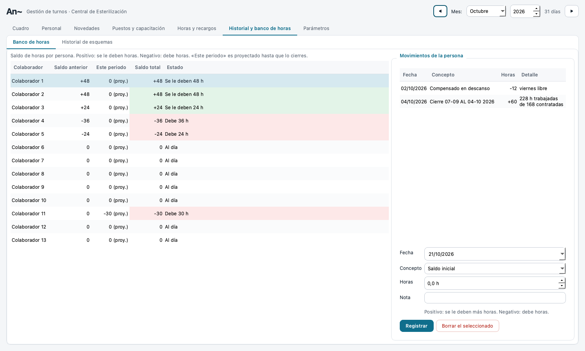
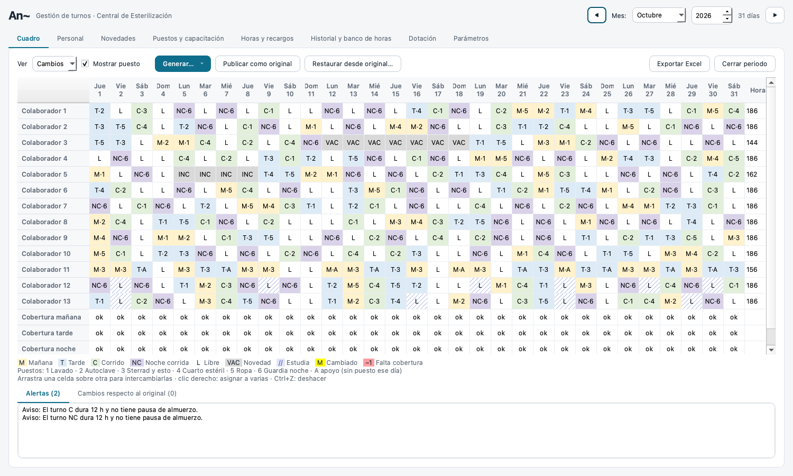

<div align="center">

# An~

**Una app de escritorio para programar turnos y los procesos que giran alrededor**<br>
Un núcleo común y un área por servicio: **Radiología** (cuadro mensual → planilla semanal) y **Esterilización** (cuadro de turnos con solver, puestos, horas y recargos).


-41CD52?logo=qt&logoColor=white)


[Guía de uso](docs/GUIA_USUARIO.md) · [Núcleo](docs/NUCLEO.md) · [Radiología](docs/RADIOLOGIA.md) · [Visión](docs/VISION.md) · [Reglas](docs/REGLAS.md) · [Arquitectura](docs/ARQUITECTURA.md) · [Hoja de ruta](docs/HOJA_DE_RUTA.md)

<br>


<sub>Cuadro de octubre de 2026 de Esterilización con datos de ejemplo: cobertura completa, descansos de 12 h y novedades (VAC, INC) respetadas.</sub>

</div>

---

## Áreas

Al abrir la app se elige el usuario local (`usuarios.json`); el usuario decide el área y cada una trabaja con sus propios datos. Cómo se enchufa un área al núcleo: [docs/NUCLEO.md](docs/NUCLEO.md).

| Área | Qué hace | Datos | Documentación |
|---|---|---|---|
| **Radiología** | Lee el cuadro mensual de radiólogos (Excel, hoja `Cambios …`) y genera el libro semanal `SEMANA dd AL dd DE MES.xlsx`: resumen, vista previa, alertas de descanso, equidad, agendas `.ics` y comparación entre versiones. También por línea de comandos. | Los Excel del coordinador | [RADIOLOGIA.md](docs/RADIOLOGIA.md), [PROYECTO.md](docs/PROYECTO.md) |
| **Esterilización** | Genera el cuadro mensual con OR-Tools, reparte puestos por tramo, calcula horas (art. 165 CST) y recargos, lleva banco de horas y exporta a Excel. | `turnos.db` (SQLite) | [Guía](docs/GUIA_USUARIO.md), [Reglas](docs/REGLAS.md), [Arquitectura](docs/ARQUITECTURA.md) |

Pensada para coordinadoras no técnicas en un **PC corporativo sin permisos de administrador**: se entrega como carpeta que se descomprime y se abre con doble clic.

## Hacia dónde va

Reglas y turnos son *datos* editables, no código; así se suman servicios sin reprogramar. Siguen más áreas, procesos administrativos vinculados (novedades, permutas, cierre para nómina) y más usuarios con roles y trazabilidad. Plan y preguntas abiertas: [VISION.md](docs/VISION.md), [HOJA_DE_RUTA.md](docs/HOJA_DE_RUTA.md).

## Esterilización: qué hace

| | |
|---|---|
| 🧮 **Cuadro con solver** | OR-Tools genera el esquema completo (un mes, o N semanas desde un lunes): la cobertura que piden los puestos, tramo a tramo, 12 h de descanso, día libre después de cada noche, al menos un día libre por semana y un fin de semana completo libre por esquema. |
| ⚖️ **Rotación y equidad** | Reparte parejo M, T, C y NC y los domingos/festivos, limita rachas de noches y de corridos, prefiere los libres en fin de semana y arrastra lo acumulado de meses anteriores. |
| ✋ **Edición ágil** | Arrastra celdas para intercambiarlas, asigna turnos a varias celdas con clic derecho y deshaz con Ctrl+Z. Los días de estudio se ven en la grilla. |
| 🗂️ **Original y cambios** | Dos versiones por mes. Lo que se edita queda en amarillo, con lista de diferencias, y se puede publicar o restaurar. |
| 👥 **Personal y novedades** | Crear, editar y eliminar colaboradores con casillas para turnos permitidos y bloques de estudio; vacaciones, incapacidades, licencias y días libres. |
| 🕘 **Turnos editables** | Crea, edita y elimina turnos: horarios, franjas que cubren, color y pausa de almuerzo (pagada o no). Todo se recalcula. |
| 🧩 **Puestos con demanda** | Crea y edita puestos con reglas de demanda: personas requeridas, horario por tramos de 30 min (también a mitad de franja o de noche), obligatorio o deseable. La cobertura sale de ahí. |
| 📍 **Reparto por puesto** | Quién ocupa cada puesto en cada tramo, respetando los puestos permitidos de cada persona, con rotación y grupos de relevo. |
| 👥 **Dotación** | Calcula cuántas personas piden los puestos: estimación por horas y verificación con el generador del mínimo que cumple todas las reglas. |
| 🎓 **Capacitación** | Una sesión por semana como máximo, el lunes o el siguiente día hábil, para que asistan todos. |
| 🏦 **Banco de horas e historial** | Cierra cada periodo y lleva el saldo por persona (a quién se le deben horas y quién las debe), con movimientos manuales y un historial de esquemas. El generador usa el saldo para compensar en el siguiente periodo, con topes. |
| 💰 **Horas y recargos** | Ventana del art. 165 CST, pendientes y adicionales, nocturno, dominical/festivo y extras con tarifas por fecha. |
| 📤 **Excel** | Cuadro mensual, planilla de puestos y reporte de horas. Nunca sobrescribe: guarda `v2`, `v3`… |

## Esterilización: cómo funciona



El solver cumple las reglas duras y optimiza el resto (horas de la ventana, rotación, equidad). Si algo no cabe, lo dice: «el 14-oct faltan 2 en la mañana» en vez de fallar en silencio. Detalle en [Arquitectura](docs/ARQUITECTURA.md).

## Esterilización: un vistazo

<table>
<tr>
<td width="50%"><br><sub><b>Puestos y capacitación.</b> Quién va en cada puesto, con el grupo de pausa (P1/P2).</sub></td>
<td width="50%"><br><sub><b>Horas y recargos.</b> Contratadas, trabajadas, pendientes y adicionales por persona.</sub></td>
</tr>
<tr>
<td width="50%"><br><sub><b>Puestos.</b> Reglas de demanda por puesto y horario.</sub></td>
<td width="50%"><br><sub><b>Dotación.</b> Personas necesarias frente al personal activo.</sub></td>
</tr>
<tr>
<td width="50%"><br><sub><b>Banco de horas.</b> Saldo por persona, con cierres y movimientos.</sub></td>
<td width="50%"><br><sub><b>Cuadro con puestos.</b> «Mostrar puesto» pasa <code>M</code> a <code>M·2</code> (autoclave).</sub></td>
<td width="50%"><br><sub><b>Personal.</b> Restricciones, puesto fijo y horario de estudio.</sub></td>
</tr>
<tr>
<td width="50%"><br><sub><b>Turnos.</b> Horarios, pausas y turnos nuevos desde la propia app.</sub></td>
<td></td>
</tr>
</table>

## Estructura

```
an/
  __main__.py        registro AREAS, selección de usuario
  nucleo/            tema, widgets, shell (Ventana), usuarios
  radiologia/        generar_semana, analisis, paginas, plantilla_semana.xlsx
  esterilizacion/    dominio, db, reglas, solver, demanda, dotacion, puestos,
                     capacitacion, recargos, flujo, exportar, paginas, ui_puestos
tests/<área>/        cada test imprime OK
docs/                guías, reglas, diseño por etapa
ejemplos/radiologia/ cuadros de prueba
```

## Empezar

**Desarrollo (Mac o Linux)**

```bash
git clone https://github.com/jssdv/an-turnos.git
cd an-turnos
python3 -m venv .venv
.venv/bin/pip install -r requirements.txt
.venv/bin/python -m an [usuario]
```

An es una sola app con un núcleo común y un área por servicio (Radiología, Esterilización); el usuario local que eliges al abrir decide el área (`docs/NUCLEO.md`). En Mac también sirve el doble clic en `An.command`: prepara el entorno la primera vez y abre la app. Los datos de Esterilización quedan en `turnos.db` y los usuarios en `usuarios.json`, junto al paquete `an`.

**Radiología por línea de comandos** (la fecha es un lunes)

```bash
.venv/bin/python -m an.radiologia.generar_semana "Asignación Radiólogos Octubre 2026.xlsx" 2026-10-19 [salida.xlsx]
```

**Paquete para Windows** (se arma desde el Mac)

```bash
./empaquetar.sh prueba   # dist/PruebaPC.zip: comprueba Qt y OR-Tools en el PC corporativo
./empaquetar.sh          # dist/An.zip: la app completa (≈ 150 MB comprimida)
```

En el PC destino basta descomprimir y abrir `An.bat`. No se instala nada.

**Pruebas**

```bash
.venv/bin/python tests/esterilizacion/test_turnos.py   # imprime OK (≈ 2 min: resuelve meses completos)
.venv/bin/python tests/esterilizacion/test_gui.py      # imprime OK (ventana sin pantalla)
.venv/bin/python tests/radiologia/test_generar_semana.py
.venv/bin/python tests/radiologia/test_gui.py
.venv/bin/python tests/nucleo/test_nucleo.py
```

## Documentación

| Documento | Para quién | Contenido |
|---|---|---|
| [Guía de uso](docs/GUIA_USUARIO.md) | Coordinación | El mes paso a paso: personal, novedades, generar, ajustar, exportar |
| [Núcleo común](docs/NUCLEO.md) | Desarrollo | Qué es núcleo y qué es área, contrato de un área, usuarios locales |
| [Radiología](docs/RADIOLOGIA.md) | Desarrollo, coordinación | Arquitectura del área y requisitos del cuadro mensual |
| [Proyecto Radiología](docs/PROYECTO.md) | Todos | Etapas hacia un sistema completo de programación |
| [Visión](docs/VISION.md) | Todos | Hacia dónde crece An~: más servicios y procesos vinculados |
| [Diseño de puestos y dotación](docs/superpowers/specs/2026-10-21-puestos-dotacion-design.md) | Desarrollo | Diseño y [plan de implementación](docs/superpowers/plans/2026-10-21-puestos-dotacion.md) de puestos con demanda y dotación |
| [Reglas y marco legal](docs/REGLAS.md) | Coordinación, RR. HH., jurídico | Reglas del servicio, normativa aplicada y puntos por confirmar |
| [Arquitectura](docs/ARQUITECTURA.md) | Desarrollo | Módulos, datos, modelo del solver, empaquetado |
| [Hoja de ruta](docs/HOJA_DE_RUTA.md) | Todos | Qué falta validar y hacia dónde crece |
| [Diseño v1](docs/DISENO_V1.md) | Desarrollo | El diseño aprobado con el que se construyó la primera versión |
| [CLAUDE.md](CLAUDE.md) | Asistentes de código | Comandos y convenciones del repositorio |

## Estado

Ambas áreas están construidas y probadas con datos sintéticos o de ejemplo; el paquete de Windows aún no se ha probado en el PC destino. Antes de usarla en producción falta [probarla en el PC corporativo y confirmar las reglas pendientes](docs/HOJA_DE_RUTA.md#antes-de-seguir-creciendo).

> **Aviso.** Las cifras de horas y recargos son de apoyo. Los porcentajes y la interpretación del art. 165 para turnos de 12 h deben confirmarse con Recursos Humanos o el área jurídica antes de usarlos en nómina. El repositorio no contiene datos del personal.
