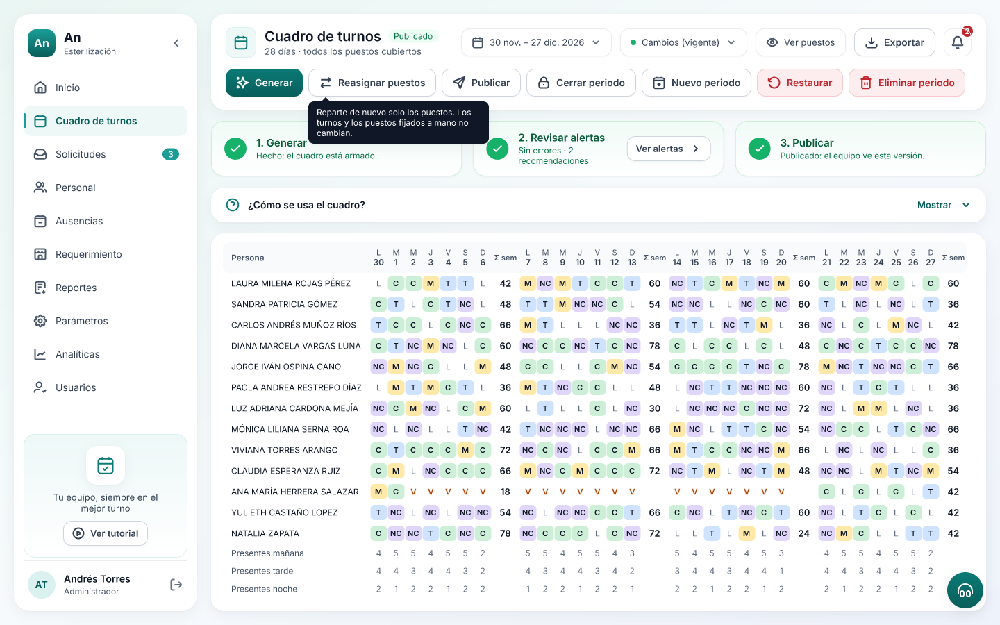
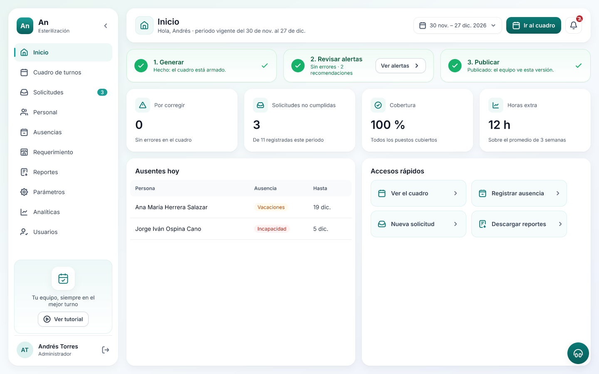
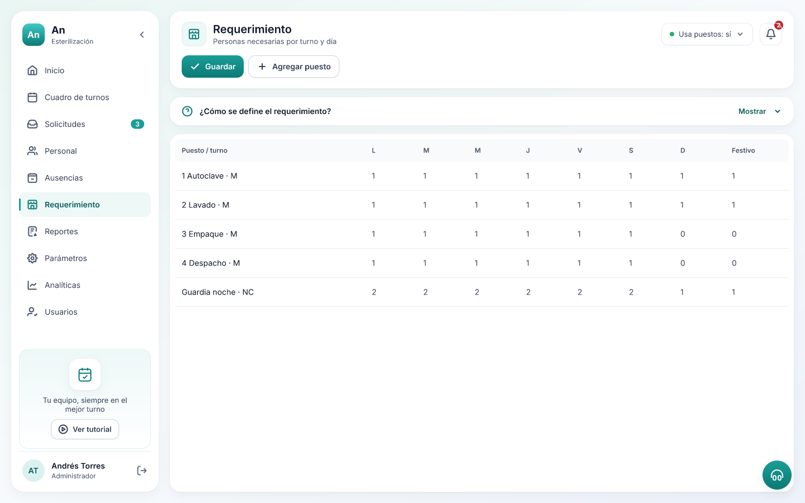
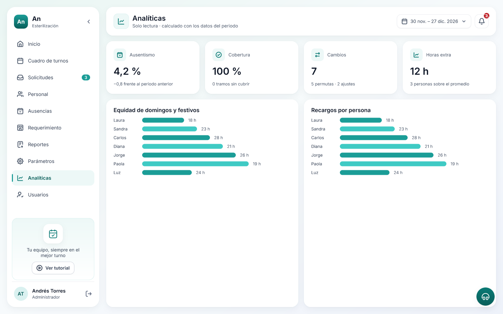
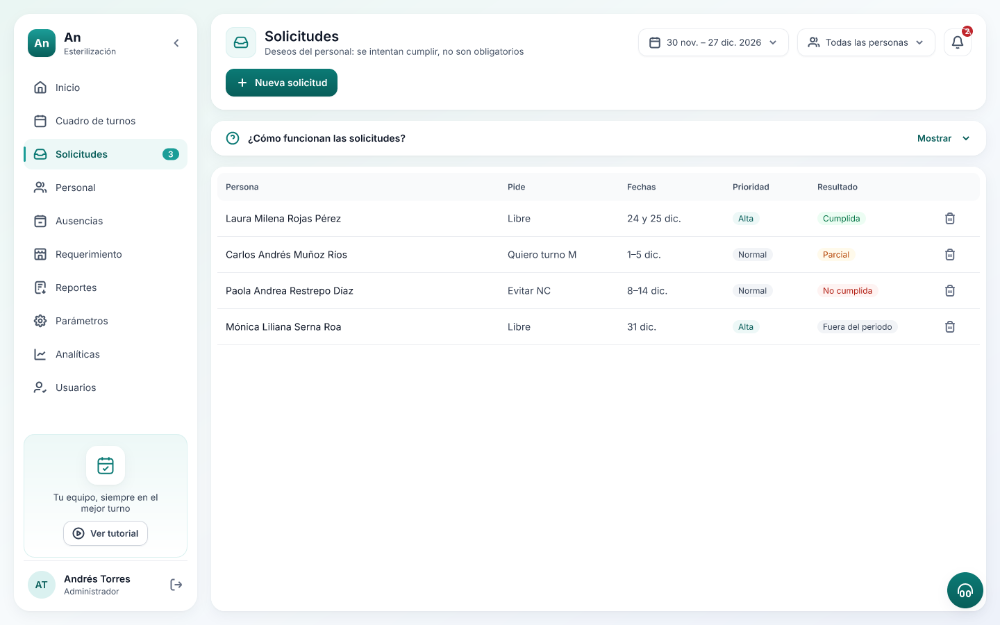
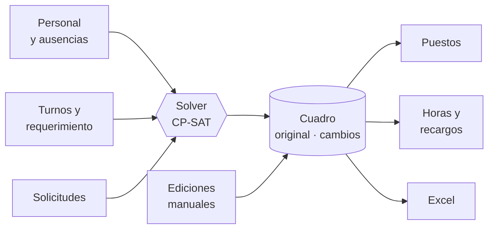

<div align="center">

# An

**Programación de turnos para equipos que trabajan por relevos.**

Genera el cuadro mensual con un solver, reparte puestos, calcula horas y recargos y deja editar a mano con trazabilidad. Corre como app portable: un doble clic, sin servidor.


[Funciones](#funciones) · [Cómo funciona](#cómo-funciona) · [Instalación](#instalación) · [Documentación](#documentación)

<br>



</div>

<br>

## Funciones

**Generación**
- Cuadro de un mes, o de N semanas desde un lunes, con OR-Tools CP-SAT.
- Cobertura por puesto y por tramo de 30 min, descansos de 12 h, libre tras cada noche, fin de semana libre y topes de rachas.
- Rotación y equidad: reparte parejo cada turno, los domingos y festivos, y arrastra lo acumulado de periodos anteriores.
- Si algo no cabe, lo dice («el 14 faltan 2 en la mañana»); no falla en silencio.

**Edición**
- Arrastrar, intercambiar y deshacer; cada cambio manual queda registrado como permuta, cambio de servicio o ajuste.
- «¿Quién cubre?»: ante una ausencia o un faltante, propone hasta 5 personas libres que pueden tomar el turno sin romper reglas, de menos a más carga, y lo asigna con un clic.
- Dos versiones por periodo: `original` (publicada) y `cambios` (copia de trabajo), con diferencias a la vista.
- Solicitudes del personal (libre, quiero, evitar) tratadas como deseos: el solver las prioriza sin romper cobertura ni normativa.

**Horas y normativa**
- Ventana de horas del art. 165 del CST, recargos nocturnos y dominicales/festivos, horas extra y banco de horas por persona.
- Cifras legales editables como datos, no como código.

**Informes**
- Analíticas: ausentismo, cobertura, cambios, horas extra y equidad.
- Exportes a Excel: cuadro, planilla de puestos, reporte de horas y banco de horas (saldos y movimientos).
- Agendas: el horario de cada persona en `.ics` para su calendario (o todas en un `.zip`) e impresión del horario de una sola persona.

**Operación**
- Varias áreas por clínica, cada una con su propio archivo de datos; permisos de edición o consulta por usuario.
- Aplicación portable para Mac y Windows; respaldos automáticos al abrir y cerrar.
- Interfaz en español, pensada para coordinadores sin perfil técnico.

## Pantallas

<table>
  <tr>
    <td width="50%"><br><sub><b>Inicio</b> · estado del periodo y accesos</sub></td>
    <td width="50%"><br><sub><b>Requerimiento</b> · personas por puesto, turno y día</sub></td>
  </tr>
  <tr>
    <td width="50%"><br><sub><b>Analíticas</b> · equidad y recargos</sub></td>
    <td width="50%"><br><sub><b>Solicitudes</b> · deseos del personal y su cumplimiento</sub></td>
  </tr>
</table>

## Cómo funciona



Las reglas y los turnos son datos editables, no código: cada área define sus turnos, puestos y demanda. El solver cumple las reglas duras y optimiza el resto (horas, rotación, equidad).

El cuadro se genera en un trabajador en segundo plano; la API y la interfaz siguen respondiendo mientras tanto.

## Instalación

**Usuarios.** Mac: doble clic en `deploy/An-mac.command`. Windows: descargar el `.exe` que genera el flujo [`entregable.yml`](.github/workflows/entregable.yml). Los datos quedan en `~/Library/Application Support/AnTurnos/` (Mac) o `%LOCALAPPDATA%/AnTurnos/` (Windows).

**Desarrollo.** Requiere Python 3.13 y Node.

```bash
git clone https://github.com/jssdv/an-turnos.git
cd an-turnos
python3 -m venv .venv
.venv/bin/pip install -r requirements.txt -r requirements-dev.txt -r requirements-web.txt
(cd web && npm ci)
web/demo.sh
```

Abre <http://localhost:5173>. Usuarios de la demo: `admin@demo.co`, `editor@demo.co`, `lector@demo.co`; clave `clave-larga-1`.

**Pruebas**

```bash
.venv/bin/python -m pytest tests --ignore=tests/turnos/test_turnos.py
.venv/bin/python tests/turnos/test_turnos.py   # ~2 min: resuelve meses completos
```

## Estructura

```
an/
  turnos/       núcleo puro: dominio, reglas, solver, puestos, recargos, exportes
  radiologia/   área adicional: cuadro mensual de Excel a planilla semanal
  web/          API FastAPI, trabajador del solver, migraciones, administración
web/            interfaz React 19 + TypeScript + Tailwind
tests/          pytest por área
docs/           reglas, arquitectura, plan y diseño
```

## Documentación

| Documento | Contenido |
|---|---|
| [Arquitectura](docs/ARQUITECTURA.md) | Módulos, datos y modelo del solver |
| [Reglas y marco legal](docs/REGLAS.md) | Reglas del servicio, normativa aplicada y puntos por confirmar |
| [Estado](docs/ESTADO.md) | Foto actual del proyecto |
| [Hoja de ruta](docs/HOJA_DE_RUTA.md) | Qué falta validar y hacia dónde crece |
| [Visión](docs/VISION.md) | Servicios y procesos vinculados que vienen |
| [Radiología](docs/RADIOLOGIA.md) | Área adicional de planillas semanales desde Excel |
| [README.md](README.md) | Comandos y convenciones para asistentes de código |

## Aviso

Las cifras de horas y recargos son de apoyo. Los porcentajes y la interpretación del art. 165 para turnos de 12 h deben confirmarse con Recursos Humanos o el área jurídica antes de usarlos en nómina. El repositorio no contiene datos del personal.
