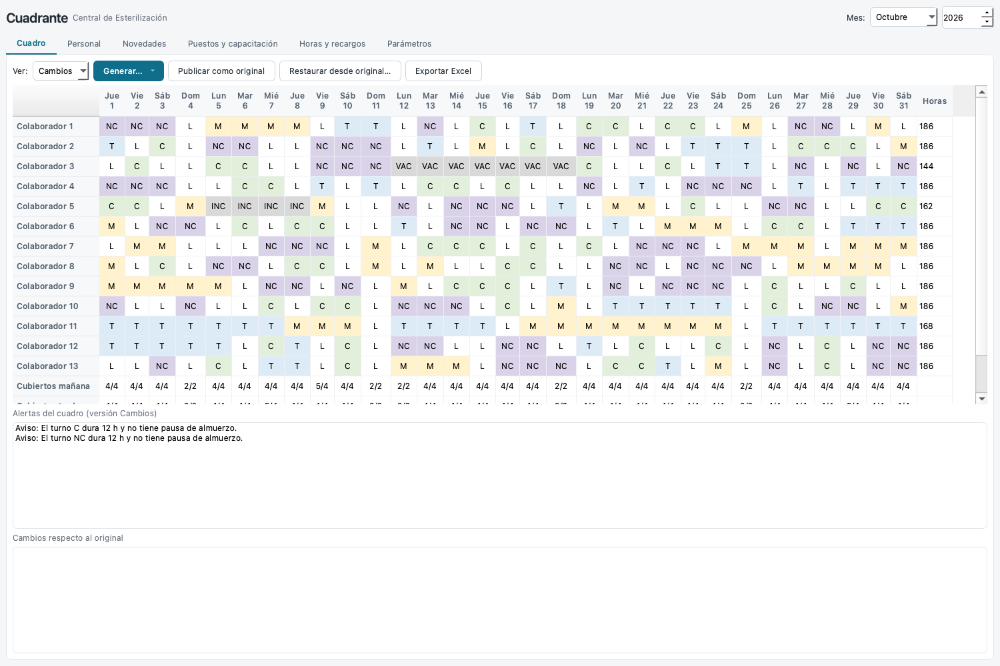
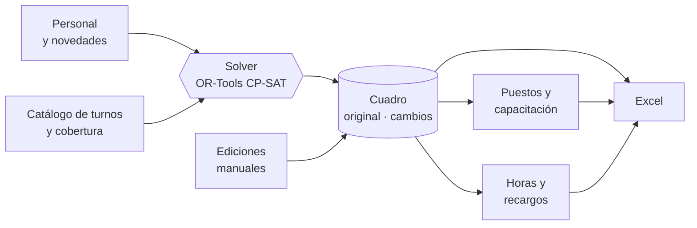
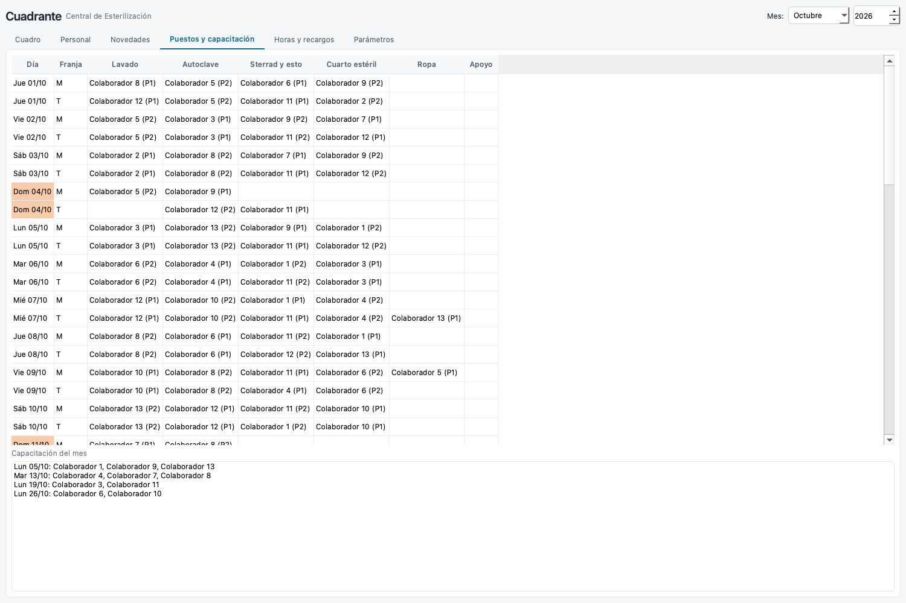
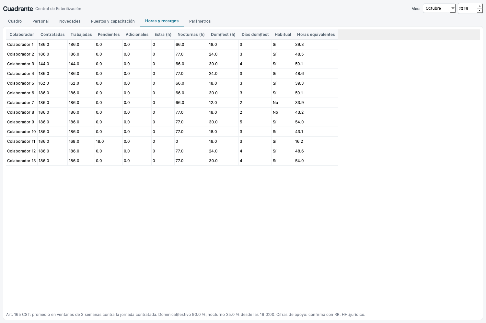
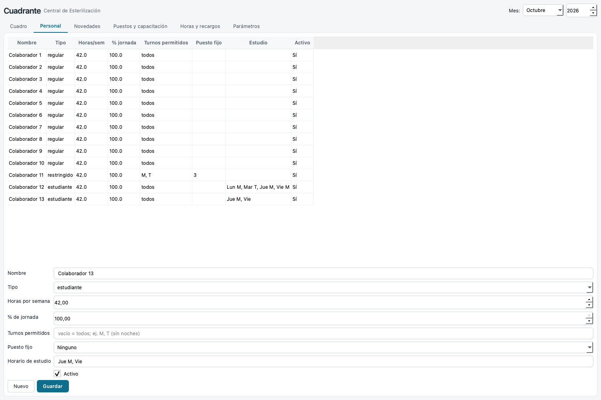
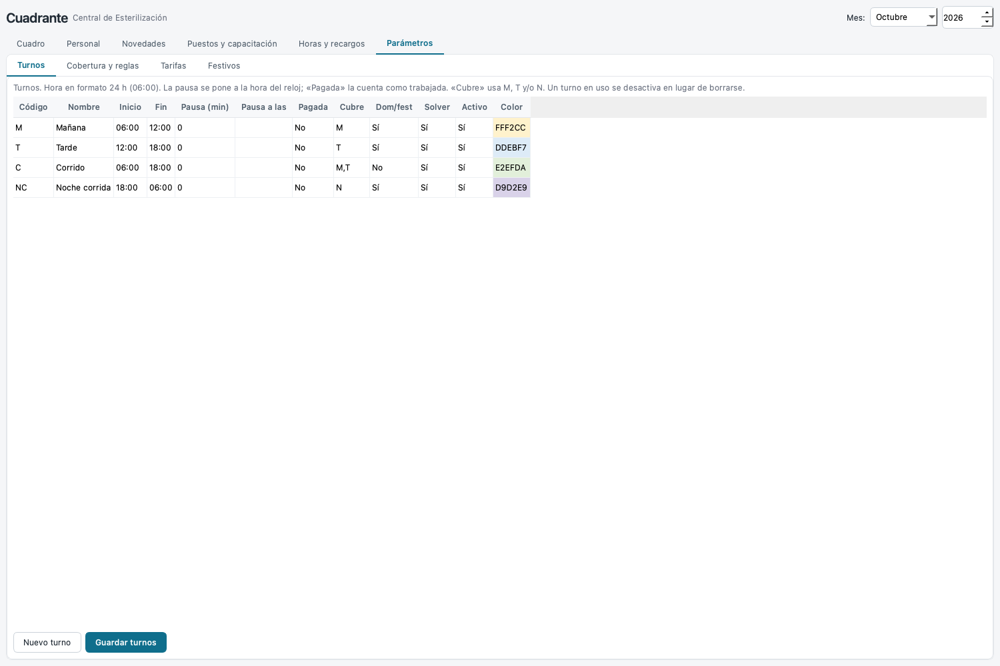

<div align="center">

# Cuadrante

**Programación de turnos para la Central de Esterilización**<br>
Genera el cuadro mensual, asigna los puestos del día y calcula horas y recargos según el Código Sustantivo del Trabajo.


-41CD52?logo=qt&logoColor=white)


[Guía de uso](docs/GUIA_USUARIO.md) · [Reglas y marco legal](docs/REGLAS.md) · [Arquitectura](docs/ARQUITECTURA.md) · [Hoja de ruta](docs/HOJA_DE_RUTA.md)

<br>



<sub>Cuadro de octubre de 2026 con datos de ejemplo: cobertura completa, descansos de 12 h y novedades (VAC, INC) respetadas.</sub>

</div>

---

## Por qué existe

Hoy el cuadro de turnos se arma a mano en Excel: ciclos que rotan, 12 colaboradores con distintas restricciones, estudiantes con horarios fijos, vacaciones, incapacidades… y después hay que contar horas y recargos. **Cuadrante** hace ese trabajo en segundos, deja que la coordinadora ajuste lo que quiera y explica cada alerta.

Está pensada para una persona no técnica en un **PC corporativo sin permisos de administrador**: se entrega como una carpeta que se descomprime y se abre con doble clic.

## Qué hace

| | |
|---|---|
| 🧮 **Cuadro con solver** | OR-Tools genera el mes completo: cobertura 4+4+2 (lunes a sábado) y 2+2+2 (domingo y festivo), 12 h de descanso entre turnos, un día libre por semana y tope de noches seguidas. |
| ⚖️ **Rotación y equidad** | Reparte noches, domingos/festivos y corridos, y arrastra lo acumulado de meses anteriores. |
| 🗂️ **Original y cambios** | Dos versiones por mes. Lo que se edita queda en amarillo, con lista de diferencias, y se puede publicar o restaurar. |
| 👥 **Personal y novedades** | Restricciones por persona, estudiantes con horario fijo, vacaciones, incapacidades, licencias y días libres. |
| 🕘 **Turnos editables** | Cambia horarios, crea turnos nuevos y define la pausa de almuerzo (pagada o no). Todo se recalcula. |
| 📍 **Puestos del día** | Lavado, autoclave, sterrad, cuarto estéril y ropa, con rotación y grupos de relevo. |
| 🎓 **Capacitación** | Una sesión por semana como máximo, el lunes o el siguiente día hábil, para que asistan todos. |
| 💰 **Horas y recargos** | Ventana del art. 165 CST, pendientes y adicionales, nocturno, dominical/festivo y extras con tarifas por fecha. |
| 📤 **Excel** | Cuadro mensual, planilla de puestos y reporte de horas. Nunca sobrescribe: guarda `v2`, `v3`… |

## Cómo funciona



El solver cumple las reglas duras y optimiza el resto (horas de la ventana, rotación, equidad). Si algo no cabe, lo dice: «el 14-oct faltan 2 en la mañana» en vez de fallar en silencio. Detalle en [Arquitectura](docs/ARQUITECTURA.md).

## Un vistazo

<table>
<tr>
<td width="50%"><br><sub><b>Puestos y capacitación.</b> Quién va en cada puesto, con el grupo de pausa (P1/P2).</sub></td>
<td width="50%"><br><sub><b>Horas y recargos.</b> Contratadas, trabajadas, pendientes y adicionales por persona.</sub></td>
</tr>
<tr>
<td width="50%"><br><sub><b>Personal.</b> Restricciones, puesto fijo y horario de estudio.</sub></td>
<td width="50%"><br><sub><b>Turnos.</b> Horarios, pausas y turnos nuevos desde la propia app.</sub></td>
</tr>
</table>

## Empezar

**Desarrollo (Mac o Linux)**

```bash
git clone https://github.com/jssdv/cuadrante.git
cd cuadrante
python3 -m venv .venv
.venv/bin/pip install PySide6-Essentials openpyxl ortools
.venv/bin/python app.py
```

En Mac también sirve el doble clic en `Cuadrante.command`: prepara el entorno la primera vez y abre la app. Los datos quedan en `turnos.db`, junto a `app.py`.

**Paquete para Windows** (se arma desde el Mac)

```bash
./empaquetar.sh prueba   # dist/PruebaPC.zip: comprueba Qt y OR-Tools en el PC corporativo
./empaquetar.sh          # dist/Cuadrante.zip: la app completa (≈ 150 MB comprimida)
```

En el PC destino basta descomprimir y abrir `Cuadrante.bat`. No se instala nada.

**Pruebas**

```bash
.venv/bin/python test_turnos.py   # imprime OK (≈ 1 min: resuelve meses completos)
```

## Documentación

| Documento | Para quién | Contenido |
|---|---|---|
| [Guía de uso](docs/GUIA_USUARIO.md) | Coordinación | El mes paso a paso: personal, novedades, generar, ajustar, exportar |
| [Reglas y marco legal](docs/REGLAS.md) | Coordinación, RR. HH., jurídico | Reglas del servicio, normativa aplicada y puntos por confirmar |
| [Arquitectura](docs/ARQUITECTURA.md) | Desarrollo | Módulos, datos, modelo del solver, empaquetado |
| [Hoja de ruta](docs/HOJA_DE_RUTA.md) | Todos | Qué falta validar y hacia dónde crece |
| [Diseño v1](docs/DISENO_V1.md) | Desarrollo | El diseño aprobado con el que se construyó la primera versión |
| [CLAUDE.md](CLAUDE.md) | Asistentes de código | Comandos y convenciones del repositorio |

## Estado

La v1 está construida y probada con datos sintéticos. Antes de usarla en producción falta [probarla en el PC corporativo y confirmar las reglas pendientes](docs/HOJA_DE_RUTA.md#antes-de-seguir-creciendo).

> **Aviso.** Las cifras de horas y recargos son de apoyo. Los porcentajes y la interpretación del art. 165 para turnos de 12 h deben confirmarse con Recursos Humanos o el área jurídica antes de usarlos en nómina. El repositorio no contiene datos del personal.
