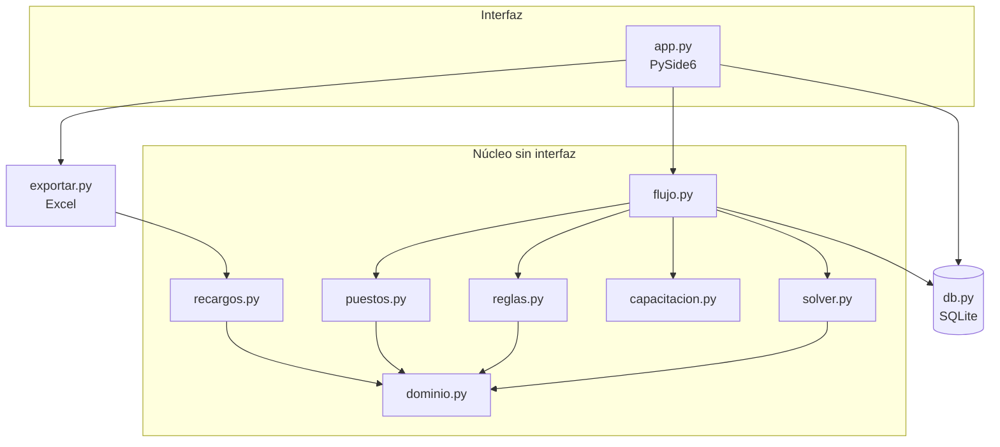

# Arquitectura

[← Volver al inicio](../README.md) · [Reglas](REGLAS.md) · [Hoja de ruta](HOJA_DE_RUTA.md)

Principios: núcleo en Python puro y sin interfaz; reglas y tarifas como **datos**, no código; Excel como formato de intercambio; todo portátil y sin permisos de administrador; el solver propone y la persona decide.

## Vista general

## Módulos

| Archivo | Responsabilidad |
|---|---|
| `dominio.py` | `Turno` (catálogo editable, pausas, `cubre` M/T/N), `Colaborador`, `Novedad`, `Contexto` (`bloqueo()` explica por qué alguien no puede hacer un turno), festivos de Colombia (Ley Emiliani) |
| `db.py` | SQLite con migraciones por `PRAGMA user_version`. Cuadro en dos versiones por mes (`original`, `cambios`) |
| `reglas.py` | Validación pura de un cuadro `{(colab_id, fecha): código}` |
| `solver.py` | Modelo CP-SAT del mes |
| `puestos.py` | Reparto de puestos: fijos, luego corridos, luego medias jornadas |
| `capacitacion.py` | Sesiones semanales |
| `recargos.py` | Horas por categoría y ventana del art. 165 |
| `flujo.py` | Orquestación (`cero`, `respetar`, `semana`) y acumulado de equidad |
| `exportar.py` | Tres libros Excel sin sobrescribir |
| `app.py` | Ventana PySide6; el solver corre en un `QThread` |

## Datos (SQLite)

`turno`, `cobertura`, `colaborador`, `novedad`, `asignacion` (mes, versión, colaborador, fecha, turno, origen, `fijo`), `puesto_dia`, `capacitacion`, `tarifa`, `parametro`. La base se crea sola en `turnos.db` junto a la app.

## Solver

Variable `x[persona, día, turno]` con L más los turnos del catálogo marcados para el solver.

**Duras:** una opción por persona y día; descanso de 12 h (transiciones prohibidas calculadas con los horarios reales); día libre después de una noche (también cuando la noche cae al final del mes anterior); mínimo de días libres por semana completa; al menos un fin de semana completo libre al mes por persona; novedades, estudio y turnos permitidos; tope de noches seguidas; celdas fijas por edición manual (si una edición manual ocupa el día libre o el fin de semana, esa regla no se exige para ese caso); continuidad con el mes anterior.

**Objetivo:** faltante de cobertura (peso muy alto) y sobrante; desviación de horas por ventana del art. 165; cambios de turno día a día; noche antes de estudio de mañana; noches y domingos/festivos en semanas seguidas; equidad de noches, domingos/festivos y corridos incluyendo meses anteriores.

Si hay celdas fijas imposibles, el error lo indica y sugiere «Restaurar».

## Versiones del cuadro

`original` se congela al generar desde cero o al publicar. Las ediciones manuales y las regeneraciones parciales solo tocan `cambios`. La grilla marca en amarillo lo distinto y el Excel trae las hojas `Cuadro`, `Original` y `Cambios`.

## Empaquetado

`empaquetar.sh` baja el Python embebido oficial y las ruedas de Windows (PySide6, openpyxl, OR-Tools) y arma una carpeta con un `.bat`. Pesa unos 400 MB descomprimida (144 MB en zip). El modo `prueba` valida Qt y OR-Tools en el PC destino.

## Interfaz y tecnología

**Decisión: seguir en Python con PySide6 (Qt).** El solver (OR-Tools), las reglas y los recargos ya son Python y se prueban sin pantalla. Cambiar de lenguaje obligaría a dividir el sistema en dos o a reescribir el núcleo, sin ganancia clara para este uso.

| Opción | Qué aporta | Por qué no por ahora |
|---|---|---|
| **PySide6 (actual)** | Interfaz nativa y madura sobre Qt 6; se empaqueta como carpeta portátil | Exige cuidar el diseño a mano, que es lo que se está haciendo |
| Electron / Tauri | Interfaz web con más libertad visual | Obliga a comunicar la interfaz con un proceso Python para el solver; Electron pesa más y Tauri depende de WebView2 |
| Flet / NiceGUI | Pocas líneas para una interfaz web | NiceGUI funciona como servidor local con navegador, poco natural para escritorio; Flet cubre bien web y móvil, que hoy no se necesitan |

Cuándo volver a evaluar: si el producto pasa a ser **multiusuario o web** (varias personas, varios servicios, aprobaciones). Entonces el núcleo Python seguiría igual detrás de una API y la interfaz sería otra.

Fuentes consultadas: [comparativa de librerías GUI de Python (Unite.ai)](https://www.unite.ai/?p=385304) y [alternativas a Electron en 2026 (TeamDev)](https://teamdev.com/mobrowser/blog/top-5-electron-alternatives-in-2026/).

### Inspiración de interfaz

De productos de turnos como [Deputy y When I Work](https://www.softwaresuggest.com/employee-shift-scheduling-software) y de [planificadores de rol de turnos tipo ERPNext](https://ecosire.com/tr/apps/erpnext/erpnext-shift-roster-planner) se toman estas ideas, ya aplicadas o en la hoja de ruta:

- **Color por turno y por estado** (aplicado: turnos con color, novedades en gris, cambios en amarillo, faltantes en rojo).
- **Alertas de cumplimiento al armar el cuadro** (aplicado: validación en vivo de descanso, cobertura y estudios).
- **No disponibilidad visible en la grilla** antes de asignar (aplicado: VAC/INC en gris y bloques de estudio en morado).
- **Arrastrar y soltar** para intercambiar turnos y **asignación en lote** de varias celdas, con deshacer (aplicado).
- **Aviso anticipado de subcobertura** (pendiente).

Las fuentes son páginas de comparación y de producto, no estudios de usabilidad; sirven como referencia de patrones, no como validación.
