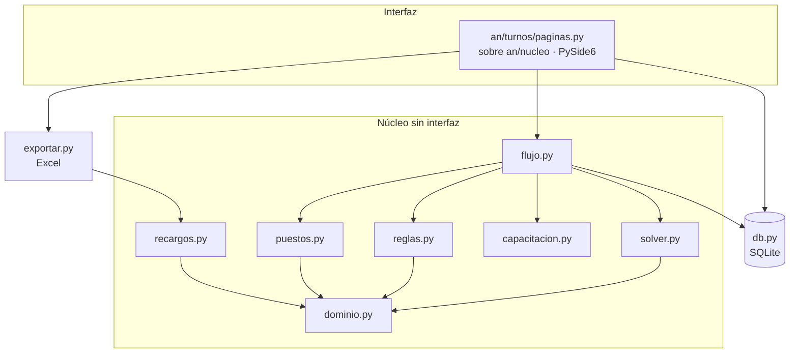

# Arquitectura

[← Volver al inicio](../README.md) · [Reglas](REGLAS.md) · [Hoja de ruta](HOJA_DE_RUTA.md)

Principios: núcleo en Python puro y sin interfaz; reglas y tarifas como **datos**, no código; Excel como formato de intercambio; todo portátil y sin permisos de administrador; el solver propone y la persona decide.

## Vista general

## Módulos

| Archivo | Responsabilidad |
|---|---|
| `dominio.py` | `Turno` (catálogo editable, pausas; `cubre` se calcula del horario), `Puesto`, `Demanda`, `AsignacionPuesto`, `Colaborador`, `Novedad`, `Contexto` (`bloqueo()` explica por qué alguien no puede hacer un turno), festivos de Colombia (Ley Emiliani) |
| `db.py` | SQLite con migraciones por `PRAGMA user_version`. Cuadro en dos versiones por mes (`original`, `cambios`) |
| `reglas.py` | Validación pura de un cuadro `{(colab_id, fecha): código}` |
| `demanda.py` | Modelo puro de la demanda por tramos de 30 min: ventanas, `demanda_fecha`, franjas de un turno, huecos sin turno, estimación por horas |
| `solver.py` | Modelo CP-SAT del periodo; cobertura por tramos |
| `puestos.py` | Reparto por tramo: un CP-SAT por día (puestos permitidos, continuidad, rotación) y textos de «Mostrar puesto» |
| `dotacion.py` | Calculadora: estimación por horas y búsqueda del mínimo de personas con el solver |
| `capacitacion.py` | Sesiones semanales |
| `recargos.py` | Horas por categoría y ventana del art. 165 |
| `flujo.py` | Orquestación (`cero`, `respetar`, `semana`) y acumulado de equidad |
| `exportar.py` | Tres libros Excel sin sobrescribir |
| `paginas.py`, `ui_puestos.py` (en `an/turnos/`) | Secciones PySide6 de esta área; puestos y dotación. Ventana, tema y helpers de tablas viven en `an/nucleo/` (ver `NUCLEO.md`). El solver y la verificación corren en `QThread` |

## Datos (SQLite)

`turno`, `cobertura` (en desuso desde la versión 4), `colaborador`, `novedad`, `asignacion` (periodo, versión, colaborador, fecha, turno, origen, `fijo`), `puesto_dia`, `capacitacion`, `tarifa`, `parametro`, y desde la versión 3 `periodo_estado` (periodos cerrados), `cierre` (foto de horas contratadas y trabajadas por persona) y `banco_mov` (movimientos manuales del banco de horas). Desde la versión 4: `puesto`, `demanda` (reglas por puesto: tipo de día, inicio, fin, personas, obligatorio) y `persona_puesto` (puestos que puede ocupar cada persona). Desde la versión 5: `asignacion_puesto` (periodo, fecha, persona, puesto, desde, hasta, pausa); `puesto_dia` queda solo para saber si un puesto tiene historial. La base se crea sola en `turnos.db` junto a la app y migra sola.

## Solver

Variable `x[persona, día, turno]` con L más los turnos del catálogo marcados para el solver.

**Cobertura por tramos:** la demanda obligatoria de los puestos se exige tramo a tramo (48 por día). Un turno aporta a los tramos que cubre su horario real; una noche aporta a la madrugada del día siguiente, y en el primer día del periodo cuentan las noches del anterior si hay datos (`previo`). Cada persona faltante pesa `W_FALTA` por tramo; con `estricto=True` (calculadora) es restricción dura. Los puestos deseables dan un premio suave (`W_DESEABLE`).

**Duras:** una opción por persona y día; descanso de 12 h (transiciones prohibidas calculadas con los horarios reales); día libre después de una noche (también cuando la noche cae al final del mes anterior); mínimo de días libres por semana completa; al menos un fin de semana completo libre al mes por persona; novedades, estudio y turnos permitidos; tope de noches seguidas; celdas fijas por edición manual (si una edición manual ocupa el día libre o el fin de semana, esa regla no se exige para ese caso); continuidad con el mes anterior.

**También duras:** máximo de noches en racha NC-L-NC-L…, máximo de corridos seguidos y máximo del mismo turno de 6 h seguido (si una edición manual cae en la ventana, esa ventana no se exige).

**Meta de horas:** la meta de cada ventana se ajusta con `ajuste` (`flujo.ajustes_banco`, a partir del saldo del banco y de los topes `banco_tope_favor_h` y `banco_tope_deuda_h`); es solo un cambio en el objetivo suave de horas, no una regla dura.

**Objetivo:** faltante de cobertura (peso muy alto) y premio por deseables; desviación de horas por ventana del art. 165; cambios de turno día a día; noche antes de estudio de mañana; noches y domingos/festivos en semanas seguidas; dos corridos seguidos; semanas sin libre en sábado o domingo; equidad de cada turno (M, T, C, NC…) y de domingos/festivos entre quienes tienen las mismas restricciones, incluyendo meses anteriores.

Si hay celdas fijas imposibles, el error lo indica y sugiere «Restaurar».

## Puestos, demanda y dotación

Un puesto es un catálogo más **reglas de demanda** (tipo de día `LS`/`DF` del día en que empieza la ventana, inicio y fin en minutos, personas, obligatoria o deseable). `demanda.py` convierte esas reglas en demanda por tramo y por fecha, incluida la parte de madrugada de las ventanas nocturnas del día anterior. La cobertura que ve la interfaz y las alertas sale de esa demanda, no de números aparte.

El reparto por persona (`puestos.asignar_tramos`) agrupa los tramos con la misma presencia y demanda en **bloques** para que cada día sea un modelo pequeño (un mes completo se reparte en una fracción de segundo). `dotacion.verificar_minimo` parte de la cota por horas, duplica hasta encontrar una cantidad factible y bisecta, con personas genéricas de jornada completa y `solver.generar(..., estricto=True)`; supone que si N personas alcanzan, N+1 también.

## Periodos

El cuadro no está atado al mes: se identifica por un **periodo** con inicio y fin, con clave `AAAA-MM-DD/AAAA-MM-DD` (`flujo.py`). El esquema puede ser un mes calendario o N semanas completas desde un lunes, según el parámetro `periodo_modo`. Las reglas entre periodos (descanso de 12 h, libre tras noche, acumulado de equidad) leen el cuadro vigente de los días anteriores sin importar a qué periodo pertenecen (`BD.asignaciones_rango`). La base pasó a la versión 2 y migra sola las claves antiguas `AAAA-MM`.

## Versiones del cuadro

`original` se congela al generar desde cero o al publicar. Las ediciones manuales y las regeneraciones parciales solo tocan `cambios`. La grilla marca en amarillo lo distinto y el Excel trae las hojas `Cuadro`, `Original` y `Cambios`.

## Empaquetado

`empaquetar.sh` baja el Python embebido oficial y las ruedas de Windows (PySide6, openpyxl, OR-Tools) y arma una carpeta con un `.bat`. Pesa unos 400 MB descomprimida (144 MB en zip). El modo `prueba` valida Qt y OR-Tools en el PC destino.

## Interfaz y tecnología

**Decisión: seguir en Python con PySide6 (Qt).** El solver (OR-Tools), las reglas y los recargos ya son Python y se prueban sin pantalla. Cambiar de lenguaje obligaría a dividir el sistema en dos o a reescribir el núcleo, sin ganancia clara para este uso.

| Opción | Qué aporta | Por qué no por ahora |
|---|---|---|
| **PySide6 (actual)** | Interfaz nativa y madura sobre Qt 6; se empaqueta como carpeta portátil | Exige cuidar el diseño a mano, que es lo que se está haciendo |
| Electron / Tauri | Interfaz web con más libertad visual | Obliga a comunicar la interfaz con un proceso Python para el solver; Electron pesa más y Tauri depende de WebView2 |
| Flet / NiceGUI | Pocas líneas para una interfaz web | NiceGUI funciona como servidor local con navegador, poco natural para escritorio; Flet cubre bien web y móvil, que hoy no se necesitan |

Cuándo volver a evaluar: si el producto pasa a ser **multiusuario o web** (varias personas, varios servicios, aprobaciones). Entonces el núcleo Python seguiría igual detrás de una API y la interfaz sería otra.

Fuentes consultadas: [comparativa de librerías GUI de Python (Unite.ai)](https://www.unite.ai/?p=385304) y [alternativas a Electron en 2026 (TeamDev)](https://teamdev.com/mobrowser/blog/top-5-electron-alternatives-in-2026/).

### Principios de diseño de la interfaz

La hoja de estilo (`an/nucleo/tema.py`, la misma para todas las áreas; ver `NUCLEO.md` por las diferencias con este diseño original) parte de **tokens** (color, radio, ritmo de 8 px) y se aplica a todo por igual:

- **Contraste y foco:** el texto cumple 4.5:1 sobre sus fondos; todos los controles muestran un anillo de foco visible al navegar con teclado.
- **Jerarquía de acciones:** una acción primaria por pantalla (relleno), secundarias con borde, destructivas en rojo y siempre con confirmación.
- **Estados vacíos que guían:** una tabla sin filas explica qué hacer; el cuadro vacío ofrece «Generar cuadro».
- **Datos:** filas alternas, números alineados a la derecha, ceros y signos consistentes (`+12`, `0`), estado siempre en texto además de color.
- **Densidad:** la grilla muestra el mes completo sin desplazarse en pantallas de 1500 px; alertas y cambios van en un panel inferior redimensionable con contador.
- **Leyenda:** los colores del cuadro tienen leyenda en pantalla; el estudio usa trama para no confundirse con la noche.

Las pautas se tomaron de las guías de [UI Taste](https://uizze.com) y de UI/UX Pro Max, adaptando lo que aplica a una app de escritorio densa; no se usó su estilo neumórfico por su riesgo de accesibilidad.

### Inspiración de interfaz

De productos de turnos como [Deputy y When I Work](https://www.softwaresuggest.com/employee-shift-scheduling-software) y de [planificadores de rol de turnos tipo ERPNext](https://ecosire.com/tr/apps/erpnext/erpnext-shift-roster-planner) se toman estas ideas, ya aplicadas o en la hoja de ruta:

- **Color por turno y por estado** (aplicado: turnos con color, novedades en gris, cambios en amarillo, faltantes en rojo).
- **Alertas de cumplimiento al armar el cuadro** (aplicado: validación en vivo de descanso, cobertura y estudios).
- **No disponibilidad visible en la grilla** antes de asignar (aplicado: VAC/INC en gris y bloques de estudio en morado).
- **Arrastrar y soltar** para intercambiar turnos y **asignación en lote** de varias celdas, con deshacer (aplicado).
- **Aviso anticipado de subcobertura** (pendiente).

Las fuentes son páginas de comparación y de producto, no estudios de usabilidad; sirven como referencia de patrones, no como validación.
