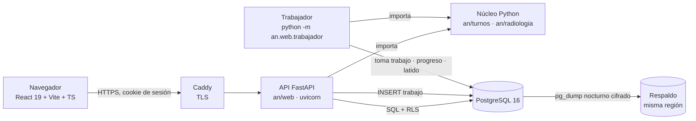

# Plan web de An

> Diseño y plan por fases para llevar An al navegador. Estado: **propuesta para aprobar** (25/10/2026). No hay código web todavía.
> Cada fase tiene, antes de programarla, su plan de tareas en `docs/superpowers/plans/AAAA-MM-DD-web-fase-N.md`.
> Contexto: [NUCLEO.md](NUCLEO.md), [ARQUITECTURA.md](ARQUITECTURA.md), [VISION.md](VISION.md), [PROYECTO.md](PROYECTO.md), [RADIOLOGIA.md](RADIOLOGIA.md).

## 0. Progreso

> Retomar en otra sesión: leer esta lista, abrir el plan detallado de la primera fase sin cerrar y seguir desde su primer `- [ ]`. Marcar `- [x]` aquí solo al cumplir la **aceptación** de la fase (§6). El avance fino vive en el plan de cada fase (`docs/superpowers/plans/`).

- [x] **Fase 0** — Decisiones y cimientos · [plan](superpowers/plans/2026-10-25-web-fase-0.md)
- [x] **Fase 1** — API sobre el núcleo + pruebas · [plan](superpowers/plans/2026-10-26-web-fase-1.md)
- [ ] **Fase 2** — Migración de `turnos.db` · plan pendiente
- [x] **Fase 3** — Trabajador del solver · [plan](superpowers/plans/2026-10-26-web-fase-3.md)
- [ ] **Fase 4** — Planilla piloto en React · plan pendiente
- [ ] **Fase 5** — Edición con revisiones y auditoría · plan pendiente
- [ ] **Fase 6** — Exportes · plan pendiente
- [ ] **Fase 7a** — Servicios tradicionales · plan pendiente
- [ ] **Fase 7b** — Radiología en la web, con lo que hace hoy (importando el cuadro mensual) · plan pendiente
- [ ] **Fase 8** — Seguridad y despliegue en la clínica piloto · plan pendiente
- [ ] **Fase 7c** — Radiología automática (se genera sola con el motor) · plan pendiente (después de la Fase 8)

Cada plan detallado se escribe al empezar su fase (no antes: depende de lo que enseñe la anterior).

## 1. Qué se busca

- **Resultado:** coordinadores de varias áreas de una o más clínicas programan turnos desde el navegador, sin instalar nada. El servidor guarda los datos, corre el solver y entrega exportes.
- **Para quién:** coordinadores no técnicos en PCs Windows bloqueados; después, administración de la clínica.
- **Éxito:** la clínica piloto arma y publica un mes completo de Esterilización en la web, con las mismas cifras (horas, recargos, alertas) que da hoy el núcleo, y sin ver datos de otra clínica.
- **Decisiones tomadas (no se reabren):** web en navegador; solver en servidor propio como trabajador de larga duración con cola (un trabajo por clínica), progreso y cancelación; datos en servidor externo con autenticación real, aislamiento por clínica y acuerdo de tratamiento (Ley 1581 de 2012); servidor = fuente de verdad con control optimista por mes; exportes de solo lectura que nunca sobrescriben; sin offline; React con diseño en FigCraft/Figma vía tokens; medir antes de optimizar.

## 2. Arquitectura

Tres contenedores de aplicación (Caddy, API, trabajador; API y trabajador usan la misma imagen) más PostgreSQL. La API sirve también el front compilado: un solo origen, sin CORS. El navegador consulta el progreso del solver cada ~1,5 s (sin WebSocket).

### Stack elegido: Opción B (FastAPI + PostgreSQL + React)

| Capa | Elección | Motivo |
|---|---|---|
| API | **FastAPI** sobre uvicorn, Python 3.13 | Importa el núcleo tal cual; un solo lenguaje para reglas, solver, analítica y exportes |
| Acceso a datos | **psycopg 3** con SQL plano a través de la clase `BD` existente | `BD` ya concentra todo el SQL (~109 llamadas en `db.py` y `cambios.py`); se porta, no se reescribe. Sin ORM |
| Migraciones | Archivos `an/web/migraciones/NNN_*.sql` + aplicador de ~20 líneas con tabla `esquema_version` | Lo mínimo; regla de App_Alianzas: una migración publicada no se edita |
| Cola | **Tabla `trabajo` en PostgreSQL** con `FOR UPDATE SKIP LOCKED` | Ver abajo |
| Front | **React 19 + Vite + TypeScript**, `react-router`, `@base-ui/react` (diálogos, menús, selects accesibles), CSS con variables en `:root` + CSS Modules | Mismo React/Vite que App_Alianzas. Sin Tailwind: los tokens ya son variables CSS y los componentes son pocos |
| Tipos API→front | `openapi-typescript` (dev) genera los tipos desde el OpenAPI de FastAPI | Sin duplicar tipos a mano |
| Gráficos | Componentes SVG propios (`Barras`, `Linea`) | `graficos.py` son 107 líneas; no hace falta Recharts |
| Auth | Propia: `hashlib.scrypt` (stdlib) + sesiones con hash SHA-256 | Mismo diseño que App_Alianzas `docs/seguridad.md` |
| Despliegue | Docker Compose en un VPS (región por confirmar), Caddy con HTTPS automático | Un servidor basta para el piloto |
| Pruebas | pytest como ejecutor (corre los tests actuales sin cambiarlos: ya son funciones `test_*`), checks `checks/*.py`, `tsc` + build del front en CI | Sin Vitest al inicio (ver §8) |

**Por qué B y no A (Express + Prisma), con datos del repo:**

1. **La lógica de negocio que toca la base es Python y es la mayoría.** `flujo`, `cambios`, `analitica`, `solicitudes`, `exportar`, `reglas`, `puestos` y `dotacion` reciben `bd` o el contexto que sale de él. En A, casi cada endpoint útil (validar tras una edición, permuta con cupo, analíticas, exportar) tendría que lanzar Python. Lo que queda en Node sería auth y CRUD de catálogos.
2. **Lanzar Python por petición cuesta.** Importar `flujo + analitica + exportar` tarda ~0,26 s en caliente (medido en el Mac de desarrollo), antes de abrir la base. Una edición de celda pasaría de decenas de ms a más de 300 ms. La alternativa en A (un servicio Python aparte) ya es B con una capa Node de más.
3. **Dos capas de datos sobre una base.** Prisma tendría su esquema en TS y `BD` el suyo en SQL: dos fuentes que se desalinean. En B hay una.
4. **Lo que A aporta y B conserva:** el front es el mismo (React + Vite + TS); de App_Alianzas se reutilizan los patrones (cadena de seguridad, permisos por módulo → por área, auditoría, `check:*`, `docs/reglas.md`, `DESIGN.md`, Compose con Postgres 16), no el lenguaje del servidor.

Coste de B: el equipo mantiene un servidor en Python y otro (Alianzas) en Node. Aceptable: el núcleo ya es Python y el front es común.

**Cola: tabla en PostgreSQL, no BullMQ/Redis.** BullMQ es de Node (quedaría fuera en B) y Redis sería un servicio más que respaldar y asegurar. Para «un trabajo por clínica» basta:
- índice único parcial `UNIQUE (clinica_id) WHERE estado IN ('en_cola','corriendo')`: un segundo «Generar» de la misma clínica responde 409 «ya hay un cuadro generándose»;
- el trabajador toma con `UPDATE … WHERE id = (SELECT id … WHERE estado='en_cola' ORDER BY creado FOR UPDATE SKIP LOCKED LIMIT 1) RETURNING *`, sondeando cada segundo;
- un trabajador para el piloto; si hay espera entre clínicas, se levantan más réplicas del mismo contenedor sin cambiar código.

**Descartadas:** A (arriba); Celery/RQ (piden Redis; la tabla cubre el caso); WebSocket/SSE (el sondeo cada 1,5 s cubre el progreso; sin tiempo real); ORM SQLAlchemy/Alembic (la `BD` existente ya es la capa de datos); Tailwind/shadcn (ver tabla); Tauri/instalador (decisión 1).

### Cambios al núcleo (los únicos)

| Archivo | Cambio | Por qué |
|---|---|---|
| `an/esterilizacion/` → `an/turnos/` | Renombrar el paquete del motor (Fase 1, antes de que `an/web/` lo importe). Lo usarán Esterilización, otras áreas tradicionales y, después, Radiología; un nombre de servicio no describe el motor. Se anota en `NUCLEO.md` y `CLAUDE.md` | Evitar un renombrado caro cuando ya haya código web encima |
| `an/turnos/db.py` | `BD` acepta una conexión ya abierta (SQLite o psycopg). El SQL se escribe en el subconjunto común: `RETURNING id` en vez de `lastrowid`, fechas desde Python en vez de `datetime('now')`, y `INSERT OR REPLACE`/`OR IGNORE` pasan a `DELETE`+`INSERT` u `ON CONFLICT DO NOTHING`. Un envoltorio de una línea cambia `?` por `%s` en psycopg. El esquema y las migraciones `PRAGMA` siguen solo para SQLite; en PostgreSQL el esquema sale de `an/web/migraciones/` | La misma `BD` sirve a Qt, a los tests rápidos en `:memory:`, a la migración y al servidor |
| `an/turnos/cambios.py` | `_log` no escribe `cambios.log` si `bd.ruta` es `None` | En el servidor el registro es la tabla `cambio_turno` |
| `an/turnos/solver.py` | `generar(…, al_avance=None, detener=None)`: un `CpSolverSolutionCallback` llama `al_avance(dict)` y un hilo vigía llama `CpSolver.stop_search()` si `detener` (un `threading.Event`) se activa; `detener` también impide el segundo intento sin fijos | Progreso y cancelación sin tocar el modelo. `stop_search` existe en OR-Tools 9.15 (instalado) |

Nada más del núcleo cambia. El aislamiento por clínica no entra al núcleo: lo pone PostgreSQL (§3).

## 3. Modelo de datos

**Aislamiento:** toda tabla con datos de una clínica lleva `clinica_id` y, si es de un área, `area_id`, ambos con `DEFAULT current_setting('app.clinica')::bigint` / `app.area`. Cada tabla tiene **Row-Level Security** (`ENABLE` + `FORCE`) con la política `clinica_id = current_setting('app.clinica')::bigint` (y `area_id` donde aplique). Cada petición abre su transacción con `set_config('app.clinica', …, true)` y `app.area`. Así el SQL del núcleo no cambia y una consulta que olvide un filtro no ve otra clínica. La aplicación conecta con un rol `an_app` que no es dueño de las tablas. El ingreso (buscar usuario por correo) y la toma de trabajos usan funciones `SECURITY DEFINER` acotadas.

**Dos «versiones» distintas:** `asignacion.version` sigue siendo `original`/`cambios` del núcleo. El control optimista es `periodo.revision` (entero); no se mezclan los nombres.

| Tabla | Origen | Columnas clave | Notas |
|---|---|---|---|
| `clinica` | nueva | id, nombre, creada | La crea el operador por línea de comandos (`python -m an.web.admin crear-clinica`) |
| `area` | nueva | id, clinica_id, tipo (`turnos`), nombre | Es el «servicio». Todas las áreas usan el motor de turnos; las diferencias (puestos, demandas, parámetros, reglas) son datos del área. Radiología (Fase 7b) usa `tipo = radiologia` mientras importa el cuadro mensual; en la Fase 7c pasa a `turnos` |
| `usuario` | nueva (reemplaza `usuarios.json`) | id, clinica_id, correo único, nombre, hash_clave, es_admin, activo, debe_cambiar | Sin registro público |
| `usuario_area` | nueva | usuario_id, area_id, permiso (`ver` \| `editar`) | Permiso por área, comprobado en servidor. Índice único parcial `(area_id) WHERE permiso = 'editar'`: **un solo usuario edita por área**; los demás solo ven |
| `sesion` | nueva | hash_token, usuario_id, creada, ultima | Token 32 bytes; solo se guarda su SHA-256 |
| `intento_login` | nueva | correo, ip, fecha | Bloqueo 5 fallos/15 min por correo+IP; en tabla para que sobreviva reinicios |
| `auditoria` | nueva (como `app_audit_log`) | fecha, usuario_id, correo, método, ruta sin parámetros, código, ip, evento | Solo crece; nunca guarda el cuerpo |
| `periodo` | nueva (absorbe `periodo_estado`) | id, area_id, clave `AAAA-MM-DD/AAAA-MM-DD`, revision, publicado_en, cerrado_en | Una fila por cuadro; la URL usa `id` |
| `trabajo` | nueva | id, clinica_id, area_id, periodo_id, tipo (`generar` \| `dotacion`), params JSON, revision_base, estado (`en_cola`, `corriendo`, `listo`, `fallido`, `cancelado`, `conflicto`), progreso JSON, cancelar, latido, resultado JSON, error, creado_por, creado, terminado | Cola y registro a la vez |
| `exporte` | nueva | id, area_id, periodo_id, tipo (`cuadro`, `puestos`, `horas`, `semana`), numero, nombre_archivo, contenido `bytea`, creado_por, creado | `numero` = máximo + 1 por (área, periodo, tipo): `v2`, `v3`…; nunca se reemplaza |
| `archivo` | nueva (Radiología 7b; deja de usarse en 7c) | id, area_id, nombre, contenido `bytea`, subido_por, subido | Cuadro mensual subido |
| `colaborador` (= persona) | núcleo | + clinica_id, area_id | Se conserva el nombre del núcleo |
| `turno`, `puesto`, `demanda`, `persona_puesto`, `novedad`, `tarifa`, `parametro` | núcleo | + clinica_id, area_id; claves primarias con `area_id` | Catálogos editables por área |
| `asignacion`, `asignacion_puesto`, `capacitacion` | núcleo | + clinica_id, area_id; `mes`/`periodo` sigue siendo la clave de texto | Índice `(area_id, mes, version, fecha)` |
| `cierre`, `banco_mov` | núcleo | + clinica_id, area_id | |
| `cambio_turno` | núcleo | + clinica_id, area_id; `servicio` queda como está (el área la da `area_id`) | Solo crece; anular = marcar |
| `solicitud` | núcleo | + clinica_id, area_id | `servicio` (fijo `esterilizacion`) se quita: lo da `area_id` |
| `puesto_dia` | núcleo, legado | + clinica_id, area_id | Se migra mientras `borrar_puesto` la consulte |
| `cobertura` | núcleo, en desuso desde v4 | — | No se crea en PostgreSQL (solo la usa la migración v4 de SQLite) |

## 4. API, seguridad y trabajador

**Cadena por petición** (dependencias/middleware de FastAPI, en este orden, como `server/app.ts`): cabeceras de seguridad (CSP solo propio origen, `frame-ancestors 'none'`, `nosniff`) → id de petición y registro → tope de cuerpo (1 MB JSON, 10 MB Excel) → sesión → `debe_cambiar` → permiso de área (`ver` para GET, `editar` para el resto) → alcance RLS (`app.clinica`, `app.area`) → auditoría. Contra CSRF: cookie `SameSite=Lax` y, en métodos que escriben, `Origin` debe ser el propio. Cookie `an_sid`, `HttpOnly`, `Secure`; vence a los 35 min sin uso y a las 12 h. Errores 5xx con mensaje genérico e id de petición (reemplaza `errores.log`).

**Rutas (forma, no lista cerrada):** `/api/auth/*`; `/api/areas/{area}/…` con catálogos (`turnos`, `puestos`, `colaboradores`, `novedades`, `solicitudes`, `parametros`, `tarifas`), `periodos/{id}` (cuadro, alertas, puestos, horas), `periodos/{id}/generar`, `periodos/{id}/cambios`, `periodos/{id}/publicar|cerrar`, `analiticas`, `exportes`; `/api/trabajos/{id}` y `/api/trabajos/{id}/cancelar`. Cada ruta llama a una función del núcleo; la API no reimplementa reglas.

**Edición con revisión:** toda escritura de un periodo envía `If-Match: <revision>`. En una transacción: `SELECT revision … FOR UPDATE`; si no coincide, 409 con la revisión actual y quién cambió; si coincide, se llama `cambios.permuta|servicio|ajuste`, se recalculan puestos, `revision + 1`, y se responde con las alertas nuevas (misma semántica del toast actual). `EditadoDespues` y `LimiteExcedido` del núcleo pasan a 409 con su mensaje.

**Trabajador:**
1. `POST …/generar {modo, lunes}` con `If-Match` crea `trabajo` (`en_cola`, `revision_base`). Responde 202 con su id.
2. El trabajador lo toma, fija el alcance RLS de esa clínica/área, llama `flujo.preparar` y `solver.generar(…, al_avance, detener)`. `al_avance` escribe `progreso` (segundos, límite, soluciones, objetivo) como máximo una vez por segundo; un hilo actualiza `latido` cada 5 s y lee `cancelar` cada segundo.
3. Al terminar, en una transacción: si `periodo.revision ≠ revision_base` → `conflicto` (no escribe nada; el usuario vuelve a generar); si no, `flujo.terminar`, `revision + 1`, `listo` con `resultado` (faltantes, solicitudes no cumplidas).
4. Cancelar: `cancelar = true` → `stop_search()` → `cancelado`, se descarta la solución.
5. Caída: al arrancar y cada minuto, lo `corriendo` con `latido` de más de 60 s pasa a `fallido` («se interrumpió; vuelve a generar»).

`reglas.validar` y `puestos.asignar_tramos` (fracción de segundo por mes) corren dentro de la petición, no en la cola. `dotacion.verificar_minimo` (muchas llamadas al solver) va a la cola como tipo `dotacion`.

## 5. Restricciones globales

- Interfaz, mensajes, nombres de hojas y etiquetas en español, tal como están hoy.
- Ningún dato del personal en Git, en logs ni en URLs; fixtures sintéticas en `tests/fixtures/`.
- Legal (art. 165 CST, 42 h/semana, recargos, tope de permutas 2) sigue siendo dato editable; nada de constantes nuevas de negocio.
- Exportes: nunca sobrescriben; todo exporte queda en `exporte` y en `auditoria`.
- Toda tabla con `clinica_id` tiene RLS activado y forzado (lo verifica `checks/rls.py`).
- Solo `an/web/trabajador.py` corre el solver de periodo; ningún proceso externo se lanza por petición.
- Solo dependencias con ruedas para Linux x86_64 en el servidor; ninguna nueva en el núcleo.

## 6. Fases

Cada fase termina en algo verificable y deja `CLAUDE.md` y los docs al día. No se empieza una fase sin cerrar la anterior. Los `- [ ]` de cada fase son el registro de avance: se marcan `- [x]` al cumplirse y se confirman en la lista de §0.

### Fase 0 — Decisiones y cimientos
- **Objetivo:** responder §10, dejar el repo listo para servidor y fijar cómo se mide.
- **Plan detallado:** [2026-10-25-web-fase-0.md](superpowers/plans/2026-10-25-web-fase-0.md)
- **Entregable:**
  - [x] Preguntas de §10 respondidas por escrito (25/10/2026)
  - [x] pytest corre los tests existentes (`requirements-dev.txt`, `pytest.ini`)
  - [x] `docker-compose.yml` de desarrollo (Postgres 16) — verificado: Postgres 16.15 `healthy` (puerto 5433, porque el 5432 lo usa el Postgres de brew)
  - [x] CI (GitHub Actions) — verde en el PR 1 con los tests del núcleo en SQLite y `checks/tokens.py`. El trabajo con Postgres entra en la Fase 1 (cuando exista `AN_BD`) y el build del front en la Fase 4
  - [x] `checks/tokens.py` y `web/src/tokens.css` generado (§7)
  - [x] `docs/REGLAS_AUTOMATICAS.md` (no `reglas.md`: choca con `REGLAS.md` en macOS)
  - [x] `VISION.md` (principios 4 y 6) y `CLAUDE.md` al día
  - [x] Borrador del acuerdo de tratamiento de datos: `docs/ACUERDO_TRATAMIENTO.md`
  - [x] Tabla de mediciones base en §8
- **Aceptación:**
  - [x] `docker compose up db` en `healthy` y la CI en verde en el PR (falta verde sobre `main`, al fusionar)
  - [x] Preguntas de §10 respondidas por escrito
- **Riesgo:** región no confirmada a tiempo → bloquea la Fase 8, no las siguientes; se desarrolla en local.

### Fase 1 — API sobre el núcleo + pruebas
- **Objetivo:** el núcleo corre igual sobre PostgreSQL y se expone por HTTP con sesión y aislamiento.
- **Plan detallado:** [2026-10-26-web-fase-1.md](superpowers/plans/2026-10-26-web-fase-1.md)
- **Entregable:**
  - [x] Paquete `an/esterilizacion/` renombrado a `an/turnos/` (imports, `AREAS`, tests, `CLAUDE.md`, `NUCLEO.md`)
  - [x] `BD` portada al subconjunto común SQLite/PostgreSQL (§2)
  - [x] `an/web/`: `app.py` (cadena de seguridad), `auth.py`, `conexion.py` (pool + alcance RLS)
  - [x] Migraciones SQL en `an/web/migraciones/` con aplicador y tabla `esquema_version`
  - [x] Rutas de catálogos y de lectura de periodos, alertas y analíticas
  - [x] `python -m an.web.admin` (crear clínica, área, usuario)
  - [x] Trabajo de CI con PostgreSQL (`AN_BD=postgres`) y `checks/rls.py`, `checks/reglas.py`
- **Aceptación:**
  - [x] `test_puestos`, `test_cambios`, `test_solicitudes`, `test_analitica`, `test_turnos` pasan con `AN_BD=sqlite` y con `AN_BD=postgres`
  - [x] `tests/web/test_aislamiento.py`: con la sesión de la clínica A, cada ruta con un id de la clínica B responde 404 y cada tabla devuelve 0 filas de B
  - [x] Login con bloqueo tras 5 fallos
  - [x] `checks/rls.py` en verde
  - [x] Solicitud sin `servicio` fijo (lo da `area_id`)
- **Riesgo:** SQL de SQLite difícil de llevar al subconjunto común → se resuelve método a método; si un caso no tiene equivalente, el método se bifurca por dialecto en `BD` y se anota.

### Fase 2 — Migración de `turnos.db` con verificación de cifras
- **Objetivo:** pasar una base SQLite existente a un área de una clínica sin perder ni alterar nada.
- **Plan detallado:** pendiente
- **Entregable:**
  - [ ] `python -m an.web.migrar turnos.db --clinica N --area M`: lee con `BD` sobre SQLite, escribe tabla a tabla en una transacción, crea `periodo` desde las claves de `asignacion` y `periodo_estado`
  - [ ] Se niega si el área ya tiene datos
  - [ ] Verificación en ambos lados con código de salida ≠ 0 si algo difiere: filas por tabla; celdas por turno por periodo y versión; `flujo.resumen_horas` por persona; `analitica.recargos_resumen`, `equidad` y `banco`; `flujo.estado_banco`; número de alertas de `reglas.validar`; `cambio_turno` y `solicitud` por periodo
- **Aceptación:**
  - [ ] Probado con el `turnos.db` actual
  - [ ] Probado con una base sintética de 3 meses
- **Riesgo:** datos antiguos con claves `AAAA-MM` o columnas nulas → la migración v2–v7 de SQLite se aplica primero abriendo con `BD` (ya migra sola).

### Fase 3 — Trabajador del solver con progreso y cancelación
- **Objetivo:** generar un periodo desde la API sin bloquearla.
- **Plan detallado:** [2026-10-26-web-fase-3.md](superpowers/plans/2026-10-26-web-fase-3.md)
- **Entregable:**
  - [x] `solver.generar(…, al_avance=None, detener=None)` (§2), con `workers` / `AN_SOLVER_WORKERS`
  - [x] `an/web/trabajador.py` y migración `004_trabajo.sql`
  - [x] Rutas `generar`, `trabajos/{id}`, `cancelar`
  - [ ] Contenedor `trabajador` (Fase 8: imagen y Compose de producción; aquí se corre con `python -m an.web.trabajador`)
- **Aceptación:** (`tests/web/test_trabajador.py`)
  - [x] Un trabajo termina en `listo` y el cuadro es igual al de `flujo.generar` con la misma semilla
  - [x] Cancelar a los 2 s deja `cancelado` en menos de 3 s y no escribe
  - [x] Un segundo «Generar» de la misma clínica da 409
  - [x] Editar el periodo mientras corre deja `conflicto`
  - [x] Matar el proceso deja `fallido` al reiniciar
  - [x] Tiempo de un mes medido en el servidor de prueba y anotado en §8
- **Riesgo:** `num_workers = 8` fijo en el solver sobre un VPS de 4 vCPU → medido (§8): 8 hilos no empeoran a 4 en el Mac; por defecto ahora es `min(8, núcleos)` y `AN_SOLVER_WORKERS` lo fija. Falta medir en el VPS real.

### Fase 4 — Planilla piloto en React (solo lectura)
- **Objetivo:** ver el cuadro de Esterilización en el navegador con el aspecto del diseño.
- **Plan detallado:** pendiente
- **Entregable:**
  - [ ] `web/` (Vite + React + TS) con tokens generados (§7) y trabajo de CI que corre `tsc` y el build
  - [ ] Componentes base (§7 paso 3) y `checks/diseno.py`
  - [ ] Pantallas Ingresar y Cambiar contraseña
  - [ ] Pantalla Cuadro: grilla con fichas por turno, marca de cambiado, cobertura, alertas
  - [ ] Pantalla Generar con barra de progreso y Cancelar
- **Aceptación:**
  - [ ] Con la base migrada de la Fase 2, la grilla muestra las mismas celdas que la app Qt para octubre 2026 (prueba que compara la API con `bd.asignaciones`)
  - [ ] Capturas del navegador junto a `docs/diseno/esterilizacion_cuadro.png` revisadas
  - [ ] Navegación completa con teclado y foco visible
  - [ ] Cuadro de un mes carga en < 1 s en el PC de referencia (medido)
  - [ ] Acceso probado desde un PC de la clínica (red, dominio, certificado)
- **Riesgo:** la grilla de un mes (≈ 40 personas × 31 días) es lenta con fichas → medir primero; virtualizar solo si supera el umbral.

### Fase 5 — Edición con revisiones y auditoría
- **Objetivo:** editar en la web con el mismo registro de cambios que Qt.
- **Plan detallado:** pendiente
- **Entregable:**
  - [ ] Edición de celda, arrastrar para permutar y lote
  - [ ] Diálogo permuta / cambio de servicio / ajuste
  - [ ] Pestaña de cambios con Anular
  - [ ] Solicitudes
  - [ ] Personal, Novedades, Puestos y Parámetros
  - [ ] Publicar y Cerrar periodo
  - [ ] Analíticas (lectura)
  - [ ] Usuarios y permisos por área para el administrador de la clínica
  - [ ] Lista de funciones de `paginas.py` con su equivalente web, revisada
- **Aceptación:**
  - [ ] Dos pestañas editan el mismo periodo: la segunda recibe 409 y ve el cuadro actualizado sin perder lo que escribió
  - [ ] Cupo de permutas y `EditadoDespues` responden igual que en `test_cambios.py`
  - [ ] Cada escritura deja fila en `auditoria` y, si es celda, en `cambio_turno`
  - [ ] Usuario con permiso `ver` recibe 403 en toda escritura
  - [ ] Un segundo usuario con permiso `editar` en la misma área se rechaza (un solo editor por área)
  - [ ] Sesión vencida a mitad de una edición: 401, la interfaz pide ingresar y conserva el cambio pendiente
- **Riesgo:** paridad con Qt incompleta → se revisa la lista de funciones al cerrar la fase.

### Fase 6 — Exportes
- **Objetivo:** descargar los mismos libros que hoy, versionados.
- **Plan detallado:** pendiente
- **Entregable:**
  - [ ] `POST …/exportes {tipo}` llama `exportar.exportar_cuadro|puestos|horas` en una carpeta temporal y guarda el resultado en `exporte`
  - [ ] Lista y descarga
  - [ ] Versión imprimible con hoja de estilo de impresión (el «PDF» es Imprimir → Guardar como PDF)
- **Aceptación:**
  - [ ] El xlsx descargado es idéntico celda a celda al que genera Qt con los mismos datos
  - [ ] Dos exportes seguidos dan `CUADRO OCTUBRE 2026.xlsx` y `… v2.xlsx`
  - [ ] Cada descarga queda en `auditoria` (`exportacion`)
- **Riesgo:** exportes grandes en `bytea` inflan la base → medir tamaño por mes; si molesta, volumen en disco con la misma tabla como índice.

### Fase 7 — Resto de áreas
Dos tipos de servicio: **tradicionales** (comparten motor y semilla con Esterilización) y **con particularidades** (reglas propias, revisión casi manual). No hay lista fija: cada clínica define sus servicios al incorporarse (pregunta 6 de §10).

**7a — Servicios tradicionales**
- **Objetivo:** una segunda área `turnos` en la misma clínica.
- **Plan detallado:** pendiente
- **Entregable:**
  - [ ] Área creada con `an.web.admin` y semilla de Esterilización, editable por la coordinación
- **Aceptación:**
  - [ ] Una segunda área genera su cuadro sin tocar los datos de la primera
  - [ ] Un usuario de una área no ve la otra (403/404)

**7b — Radiología en la web, con lo que hace hoy**
- **Objetivo:** hacer en el navegador todo lo que hace hoy la app Qt de Radiología, importando el cuadro mensual.
- **Plan detallado:** pendiente
- **Entregable:**
  - [ ] Subir el cuadro mensual (`.xlsx`, ≤ 10 MB, `data_only=True`) a `archivo`
  - [ ] Elegir semana; Resumen, Vista previa, Alertas, Equidad, Agendas (`.ics`) y Cambios
  - [ ] Descargar `SEMANA … .xlsx` vía `exporte`
  - [ ] Paridad con `an/radiologia/paginas.py`: lista de funciones con su equivalente web, revisada
- **Aceptación:**
  - [ ] El libro de la semana del 19 al 25 de octubre sale igual (celdas) que el de la app Qt
  - [ ] `tests/radiologia/test_generar_semana.py` sigue pasando
  - [ ] Archivo que no es `.xlsx` o pasa de 10 MB se rechaza con mensaje en español
  - [ ] Un usuario de Radiología no ve otras áreas (403/404)
- **Riesgo:** el cuadro guardado sin Excel trae fórmulas sin valor → se muestra el mensaje de `ErrorPlanilla` tal cual.

**7c — Radiología automática (después de la Fase 8)**
- **Objetivo:** Radiología se genera sola con el motor, sin importar el cuadro mensual. Es el primer servicio con particularidades; cada clínica trae los suyos (pregunta 6 de §10).
- **Plan detallado:** pendiente
- **Entregable:**
  - [ ] Doc de diseño `docs/superpowers/specs/…` antes de programar: qué reglas de Radiología (contingencia, vacaciones, densitometría con domingo, hemodinamia no publicada, `Z`) son datos de `puesto`/`demanda`/`parametro` y cuáles piden ganchos mínimos en `reglas.py`/`solver.py`
  - [ ] Libro semanal `SEMANA … .xlsx` generado desde el cuadro generado, vía `exporte`
  - [ ] Asignación de estudios y notas libres siguen manuales; la revisión usa ediciones `fijo`, avisos que no bloquean y auditoría (sin marca nueva en el esquema)
  - [ ] Importar el cuadro mensual se retira; `archivo` deja de usarse
- **Aceptación:**
  - [ ] El libro de la semana sale igual (celdas) que el de 7b con las mismas entradas, o las diferencias quedan listadas y aceptadas por escrito
- **Riesgo:** las particularidades no caben en datos → se anotan los ganchos mínimos en el doc de diseño; no se abre un tipo de área nuevo.

### Fase 8 — Seguridad y despliegue en la clínica piloto
- **Objetivo:** operar con datos reales de una clínica.
- **Plan detallado:** pendiente
- **Entregable:**
  - [ ] VPS en la región acordada con Compose de producción (Caddy, API, trabajador, Postgres sin puerto público)
  - [ ] `pg_dump` nocturno cifrado fuera del servidor, con prueba de restauración
  - [ ] `docs/seguridad.md` y `docs/operacion.md`
  - [ ] Acuerdo de tratamiento firmado
  - [ ] Auditoría de seguridad (`/security-audit`) sin hallazgos altos abiertos
  - [ ] Capacitación y 2–4 semanas en paralelo con el proceso actual
  - [ ] Qt retirado y etiqueta `qt-final` (si la decisión 3 de §10 se mantiene)
- **Aceptación:**
  - [ ] Restauración de un respaldo en un servidor limpio con cifras iguales (script de la Fase 2 contra el respaldo)
  - [ ] Un mes real publicado desde la web
  - [ ] Lista de hallazgos cerrada o aceptada por escrito
- **Riesgo:** la red de la clínica bloquea el dominio o el certificado → probar acceso desde un PC de la clínica en la Fase 4, no al final.

## 7. Diseño: de FigCraft a componentes

1. **Fuente:** un solo archivo manda (pregunta 4 de §10; recomendación: FigCraft). `An_UI.figcraft` es un zip con `document.json`; sus variables están en `variables` (hoy solo la colección «Color», con los mismos nombres que `tema.C`). Se añaden en el archivo las colecciones «Espacio», «Radio» y «Tipo».
2. **Exportación:** `checks/tokens.py` (stdlib) lee `document.json` y escribe `web/src/tokens.css` (`:root { --fondo: #F5F7FA; … }`). Con `--verificar` falla si `tokens.css` o `tema.C` no coinciden con el archivo. Mientras Qt exista, `tema.C` se compara, no se genera.
3. **Componentes base, en este orden:** `Boton` (primario, secundario, peligro), `Campo` (texto, número, fecha, select), `Tarjeta`, `Tabla` (con estado vacío), `Ficha` (celda de turno: color del turno, marca de cambiado, novedad, faltante), `Planilla` (grilla que usa `Ficha`), `Aviso` (banner y toast), `Dialogo`, `Lateral` (menú del área con insignias), `Progreso`. Todas las áreas usan estos; ninguna trae estilos propios (regla de `NUCLEO.md`).
4. **Verificación:** `checks/diseno.py` falla con colores literales fuera de `tokens.css`, texto por debajo del mínimo de la colección «Tipo» y pares de tokens sin contraste 4,5:1 (mismo enfoque que `check:diseno` de App_Alianzas). Capturas de cada pantalla (navegador sin cabeza) se guardan junto a las de `docs/diseno/` y se revisan a ojo en cada fase; no hay comparación automática de píxeles al inicio.

## 8. Rendimiento y pruebas

**Medir primero.** En la Fase 0 se fija la tabla; cada fase anota sus cifras.

| Medida | Dónde | Umbral para actuar | Base (Fase 0, 25/10/2026, Mac M5 de 10 núcleos) |
|---|---|---|---|
| Solver, un mes completo (p50/p95) | Trabajador en el VPS | > 60 s | 20,2 s en las 3 corridas (13 personas, octubre 2026): agota el límite de `tiempo=20` en vez de converger. **Fase 3 (26/10/2026, `checks/medir_solver.py`, mismo Mac):** primera solución a los 0,2 s (8 hilos) / 0,4 s (4) / 0,5 s (2) / 2,1 s (1); no converge a óptimo: sigue mejorando hasta el límite (objetivo final con `tiempo=20`: 2265 con 8 hilos, 2730 con 4; con `tiempo=60`: 975 / 600 / 865 con 8 / 4 / 2 hilos, sin faltantes). Con 1 hilo la solución es mala (60 s: objetivo 1,3 M y 84 tramos sin cubrir), con 2 o más es parecida. Falta repetirlo en el VPS real |
| `GET` del cuadro de un mes | API | > 300 ms | n/a hasta Fase 1 |
| Edición de una celda, ida y vuelta con alertas | API + navegador | > 500 ms | n/a hasta Fase 5 |
| Pintar la grilla de un mes | Navegador del PC de la clínica | > 1 s | n/a hasta Fase 4 |

Candidatos, solo si una medida pasa su umbral: pista al solver con la solución previa (`AddHint`), `num_workers` según núcleos, dividir por semana (`modo="semana"` ya existe), índices y escritura por lotes (`executemany`) en `BD`, virtualizar la grilla, cargar solo el rango visible.

**Pruebas:** los tests del núcleo siguen siendo scripts que imprimen `OK` y además los corre pytest; en CI corren dos veces (`AN_BD=sqlite` y `AN_BD=postgres`). `tests/web/` (pytest + `httpx` de FastAPI) cubre auth, aislamiento, revisiones, trabajador y exportes. Front: `tsc --noEmit` y build en CI; Vitest solo cuando un componente tenga lógica propia (p. ej. selección por lote en `Planilla`). Checks: `checks/rls.py`, `checks/tokens.py`, `checks/diseno.py`, `checks/reglas.py` (toda ruta declara permiso de área; nada de SQL con f-strings; `subprocess` solo en el trabajador).

## 9. Qué NO hacer

- Sin tiempo real (WebSocket/SSE): el sondeo basta.
- Sin SSO ni segundo factor; sin registro público.
- Sin app móvil ni vista para cada colaborador (Etapa 5 de `PROYECTO.md`, fuera de este plan).
- Sin reescribir el solver (ni en Rust ni en TS); solo los ganchos de §2.
- Sin abstracciones para áreas que no existen: dos tipos de área (`turnos`, y `radiologia` hasta la Fase 7c); las particularidades de un servicio son datos o ganchos mínimos del motor, no un tipo nuevo. Sin marca "revisión manual" en el esquema.
- Sin reimportar Excel editado como fuente (Radiología 7b es la única excepción, hasta la Fase 7c); sin modo offline.
- Sin Redis, Celery, ORM ni Kubernetes.
- Sin panel de superadministración: clínicas y áreas por línea de comandos.

## 10. Preguntas abiertas

| # | Pregunta | Recomendación | Respuesta |
|---|---|---|---|
| 1 | ¿Región del servidor? | Colombia si el cliente lo exige; si no, la región más cercana de un proveedor en un país que la SIC reconozca con nivel adecuado de protección (verificar la lista vigente), con la transferencia escrita en el acuerdo de tratamiento. Respaldos en la misma región. | No hay restricción (25/10/2026). Se elige la región más cercana y económica; la transferencia y los respaldos se escriben en el acuerdo. |
| 2 | ¿Una clínica o varias desde el inicio? | Esquema multiclínica desde la Fase 1 (RLS cuesta lo mismo ahora y es caro después), pero operar una sola clínica hasta cerrar la Fase 8. | Varias clínicas, operadas desde el inicio (25/10/2026). Cada clínica crea sus servicios. |
| 3 | ¿Qt se mantiene en paralelo o se reemplaza? | Se reemplaza. Hoy no está en uso (falta probarlo en el PC corporativo, paso 0.6 de `PROYECTO.md`). Se congela en una etiqueta `qt-final`, solo correcciones hasta la Fase 5, y se retira al cerrar la Fase 8. `BD` seguirá aceptando SQLite por los tests rápidos y la migración. | Se reemplaza (25/10/2026). |
| 4 | ¿FigCraft o Figma es la fuente de diseño? | FigCraft: ya tiene los tokens con los nombres de `tema.C`, se lee con stdlib y está en el repo. Figma queda para explorar; lo que se adopte se pasa a FigCraft antes de programarlo. | FigCraft (25/10/2026). |
| 5 | ¿Quién crea los usuarios en la clínica? | Un administrador de la clínica (`es_admin`) gestiona usuarios y permisos de su clínica desde la web (Fase 5); el operador crea solo el primero. | Un administrador por clínica (`es_admin`) crea usuarios; **un solo usuario edita por área**, los demás solo ven (25/10/2026). |
| 6 | ¿Qué servicios son tradicionales y cuáles tienen particularidades? | Lista escrita antes de la Fase 7: dimensiona 7a y cuántos diseños de 7b hacen falta. Radiología es el primero de 7b. | Muchos servicios; depende de cada clínica (25/10/2026). No hay lista global: cada clínica clasifica los suyos al incorporarse. |
| 7 | ¿Radiología necesita la web antes de poder generarse sola? | Si no, sin puente (se omite `archivo` y la subida). Si sí, puente transitorio. | Sí (25/10/2026): Radiología en la web con lo que hace hoy (importando el cuadro mensual). Es la Fase 7b. |
