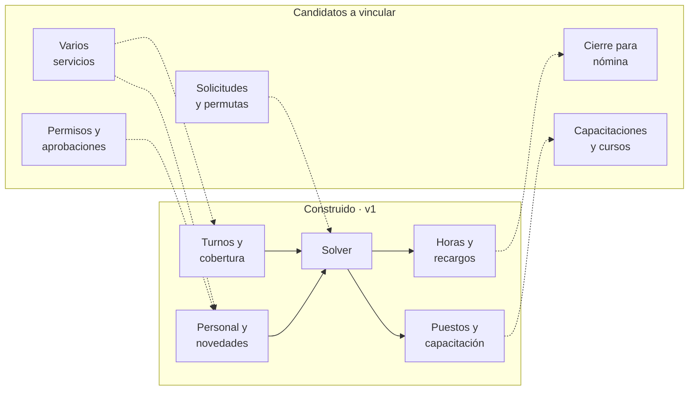

# Visión

[← Volver al inicio](../README.md) · [Hoja de ruta](HOJA_DE_RUTA.md) · [Arquitectura](ARQUITECTURA.md) · [Reglas](REGLAS.md)

**An~** nace para programar los turnos de la Central de Esterilización. La intención es que sea la base de una herramienta general de **gestión de turnos**, a la que se puedan sumar otros servicios y los procesos administrativos que dependen de ellos.

> Estado: la v1 cubre **solo Esterilización**. Este documento describe la dirección; no promete nada que ya exista. Lo construido está en la [arquitectura](ARQUITECTURA.md) y lo pendiente en la [hoja de ruta](HOJA_DE_RUTA.md).

## Qué problema resuelve

Programar turnos bien exige cumplir cobertura, descansos, restricciones personales y normativa laboral a la vez, y después contar horas y recargos. Hecho a mano consume días y deja errores. La idea es que el sistema proponga, valide y explique, y que la persona decida.

## Principios

1. **La persona decide.** El solver propone; la coordinación ajusta, publica y deja constancia de los cambios.
2. **Reglas como datos.** Turnos, cobertura, puestos y tarifas se editan desde la app. Agregar un servicio o cambiar una ley no debe exigir programar.
3. **Núcleo sin interfaz.** El dominio, las reglas y el solver son Python puro; la interfaz solo los llama. Así la misma lógica puede servir desde otra interfaz o un servidor.
4. **Portátil y sin permisos.** Debe funcionar en un PC corporativo sin administrador.
5. **Excel como puente.** Entra y sale en Excel mientras los demás procesos sigan allí.
6. **Datos personales protegidos.** Los datos del personal no salen del equipo ni del repositorio (Ley 1581 de 2012).
7. **Etapas pequeñas que sirven solas.**

## Piezas y cómo se vinculan

Las líneas punteadas son ideas, no compromisos.

## Qué cambiaría para crecer

| Tema | Hoy | Para varios servicios |
|---|---|---|
| Servicio | Uno, implícito | Entidad `servicio` con sus turnos, cobertura, puestos y personal |
| Puestos | Los 5 de Esterilización | Catálogo de puestos por servicio |
| Reglas | Parámetros globales | Reglas por servicio sobre el mismo motor |
| Esquema | Mes calendario o N semanas desde un lunes, igual para todo | Esquema propio por servicio (mes, semanas, otro día de inicio) |
| Personal | Una lista | Personas que pueden pertenecer a más de un servicio |
| Usuarios | Una persona, un equipo | Varias personas y roles (coordina, aprueba, consulta) |
| Datos | SQLite local | SQLite compartido o base de servidor, según el hospital |
| Salidas | 3 Excel | Más formatos y un cierre de horas para nómina |

## Procesos administrativos candidatos

- **Solicitudes y permutas** entre colaboradores, con aprobación y registro de quién, cuándo y por qué.
- **Novedades** con soporte (por ejemplo, incapacidades) y su efecto en horas contratadas.
- **Cierre de nómina**: horas por categoría y recargos en el formato que pida Recursos Humanos.
- **Capacitaciones** como proceso propio, con asistencia y vencimientos.
- **Permisos, vacaciones y su aprobación**, con saldos.

Cada uno se diseñará cuando se pida, con su documento en `docs/` antes de programarlo.

## Preguntas abiertas

1. ¿Qué otros servicios usarían la herramienta y qué tan distintas son sus reglas?
2. ¿Quién aprobaría solicitudes y cambios, y con qué flujo?
3. ¿Qué formato pide Recursos Humanos o nómina para recibir las horas?
4. ¿Dónde se guardarían los datos si lo usa más de una persona: un equipo, una carpeta compartida o un servidor del hospital?
5. ¿Existe un sistema de personal con el que habría que integrarse?
6. Qué debe aprobar jurídico sobre jornada, turnos de 12 h y recargos ([puntos por confirmar](REGLAS.md)).
